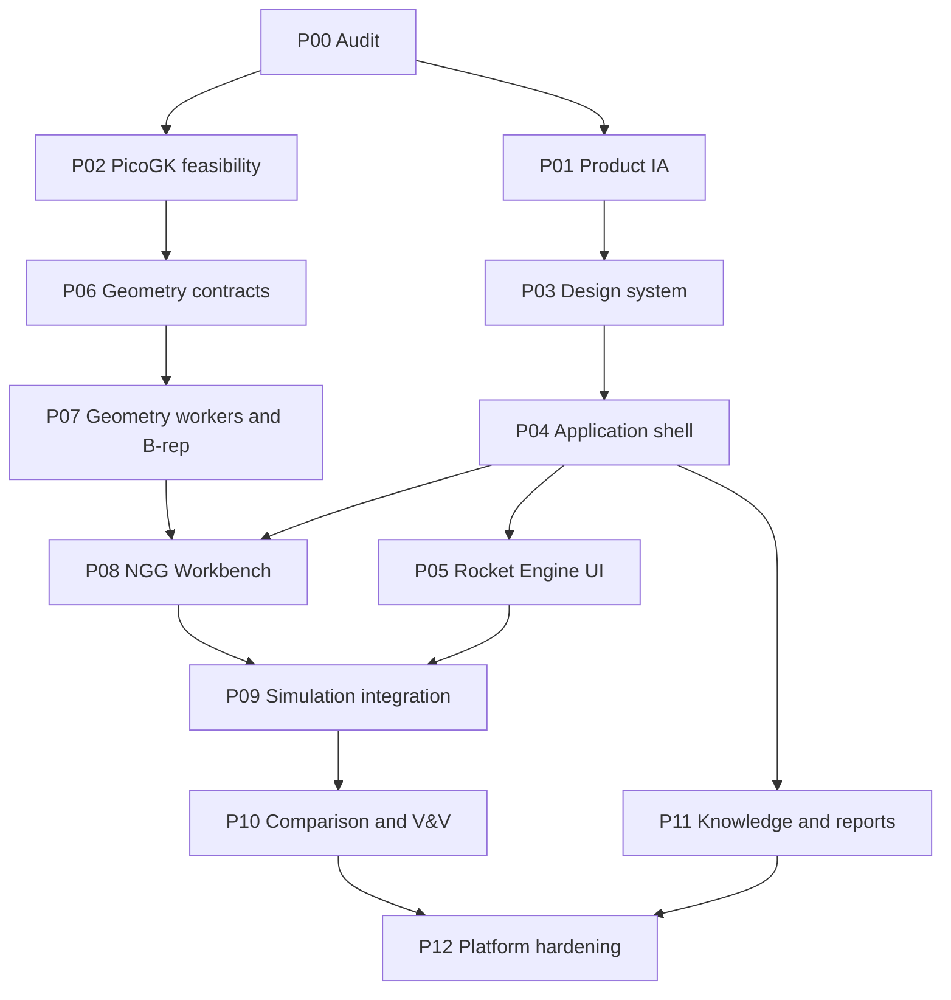

> **Status:** Developer specification. Not proof of repository implementation.
> **Authority:** Frozen COSMOS architecture PDF is a design baseline, not a current source-code audit. Verify against pinned Git commit before changing files.
> **Language:** Controlled technical English inspired by ASD-STE100 principles. Formal ASD-STE100 compliance is **not certified**. Use short sentences, defined terms, active voice, and one requirement per statement.

# Execution sequence and task dependencies

## Sequence
- **P00** inventory and audit. No implementation changes.
- **P01** information architecture and workflow prototypes. Preserve user task flows.
- **P02** independent PicoGK feasibility and license assessment. No production linkage yet.
- **P03** shared UI design system and component contracts.
- **P04** application shell and project dashboard. Use feature flags.
- **P05** Rocket Engine Workbench modernization. Require physics parity.
- **P06** versioned geometry input, design graph, provenance and units.
- **P07** geometry worker, implicit adapter, B-rep backend, exports, independent QA.
- **P08** NGG UI and geometry viewer.
- **P09** simulation workbench and geometry handoff.
- **P10** Comparison and V&V Workbench.
- **P11** Maharshi Bharadwaj and report UI.
- **P12** integration, performance, accessibility, CI, packaging, release signoff.

## Parallelism
P01 and P02 may proceed after P00. P05 and P06 may proceed after their independent prerequisites. P11 may start after P04. Do not integrate unverified geometry into production simulation.

## Cadence
Use one scoped change set per contract or UI component. Do not combine kernel upgrades with unrelated UI changes. Run a focused test suite for every change set and a full regression suite at every release gate.
