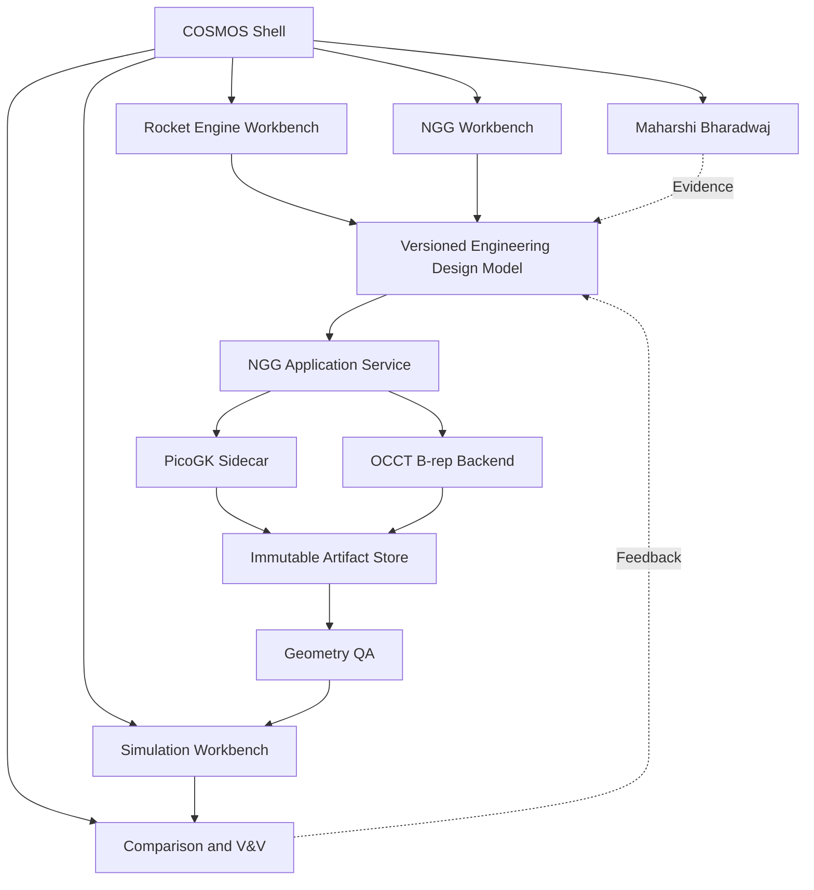

# COSMOS target architecture — conceptual

**Diagram type:** logical target architecture, not current repo evidence. **Review:** validate arrows and service ownership against frozen architecture before implementation.
