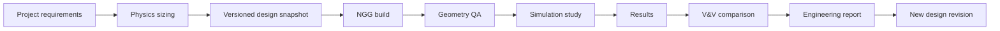

> **Status:** Developer specification. Not proof of repository implementation.
> **Authority:** Frozen COSMOS architecture PDF is a design baseline, not a current source-code audit. Verify against pinned Git commit before changing files.
> **Language:** Controlled technical English inspired by ASD-STE100 principles. Formal ASD-STE100 compliance is **not certified**. Use short sentences, defined terms, active voice, and one requirement per statement.

# Platform-wide information and experience architecture

## Main navigation
1. Projects and Mission Workspace.
2. Rocket Engine Workbench.
3. Native Geometry Generator.
4. Simulation Workbench.
5. Comparison and V&V Workbench.
6. Maharshi Bharadwaj Knowledge.
7. Reports, History and Governance.

## Global shell
Persistent project selector, current revision, unit preference (display only), run queue, notifications, command palette, help, breadcrumbs, and contextual source links. The shell MUST support keyboard navigation and persisted panel layouts.

## Layout model
Left: project tree and workbench navigation. Center: main editor/viewport. Right: contextual inspector. Bottom: diagnostics, history and task queue. Panels MUST be resizable, collapsible and recoverable to defaults.

## Engineering user journey

## Interaction modes
Guided, Standard, Expert. These modes change presentation density and explanation only. They MUST NOT silently change numerical defaults, geometry tolerance or solver models.

## UX-001 through UX-008
- UX-001 MUST keep the current project and revision visible.
- UX-002 MUST distinguish draft, stale, running, failed, verified and validated states.
- UX-003 MUST show units next to numerical values.
- UX-004 MUST provide source/assumption inspection from each supported result.
- UX-005 MUST allow the user to navigate upstream from a result to its input snapshot.
- UX-006 MUST not block the main event loop during computation.
- UX-007 MUST preserve focus and keyboard operation across dock panels.
- UX-008 MUST use explicit confirmation for destructive actions.

## Acceptance scenarios
Open an existing project; switch workbenches; edit a parameter; inspect the dependency impact; create a new revision; generate geometry; inspect warnings; return to the original revision without data loss.
