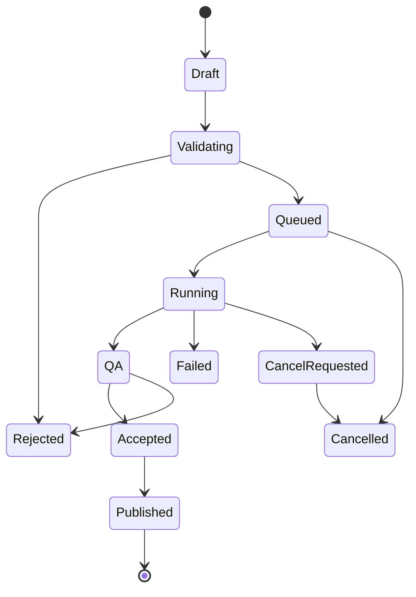

> **Status:** Developer specification. Not proof of repository implementation.
> **Authority:** Frozen COSMOS architecture PDF is a design baseline, not a current source-code audit. Verify against pinned Git commit before changing files.
> **Language:** Controlled technical English inspired by ASD-STE100 principles. Formal ASD-STE100 compliance is **not certified**. Use short sentences, defined terms, active voice, and one requirement per statement.

# Data contracts and state machine

## Suggested schemas (adapt to existing dataclasses)
`DesignSnapshot`: schema_version, project_id, revision_id, parameters_si, frame_id, source_refs, created_at, sha256.
`GeometryBuildRequest`: request_id, snapshot_id, feature_graph_id, backend_id, backend_version, representation, tolerance_m, output_formats.
`GeometryBuildEvent`: job_id, seq, timestamp, state, stage, progress_fraction, code, message, evidence_refs.
`GeometryArtifact`: artifact_id, job_id, representation, units, frame_id, sha256, topology_report_id, storage_uri, generated_at.
`GeometryValidationReport`: report_id, artifact_id, checks[], acceptance_policy_id, reviewer_id?, disposition.
`NamedSelection`: semantic_id, geometry_revision_id, feature_ref, entity_refs, remap_confidence, mapping_status.
`SimulationHandoff`: geometry_artifact_id, named_selections[], material_regions[], coordinate_frames[], mesh_constraints[], integrity_report_id.

## Build state machine

## Invariants
Sequence numbers increase per job. A published artifact is immutable. A failed or cancelled job has no published artifact. Revisions are never overwritten. Stale status is computed from dependencies, not a user-editable Boolean. Reuse existing persistence contracts if present.

## API design
Prefer current COSMOS API style. Define endpoints or application service methods only after audit. Contract tests MUST exercise request/response serialization, worker crash, cancellation, invalid units and stale design revision.
