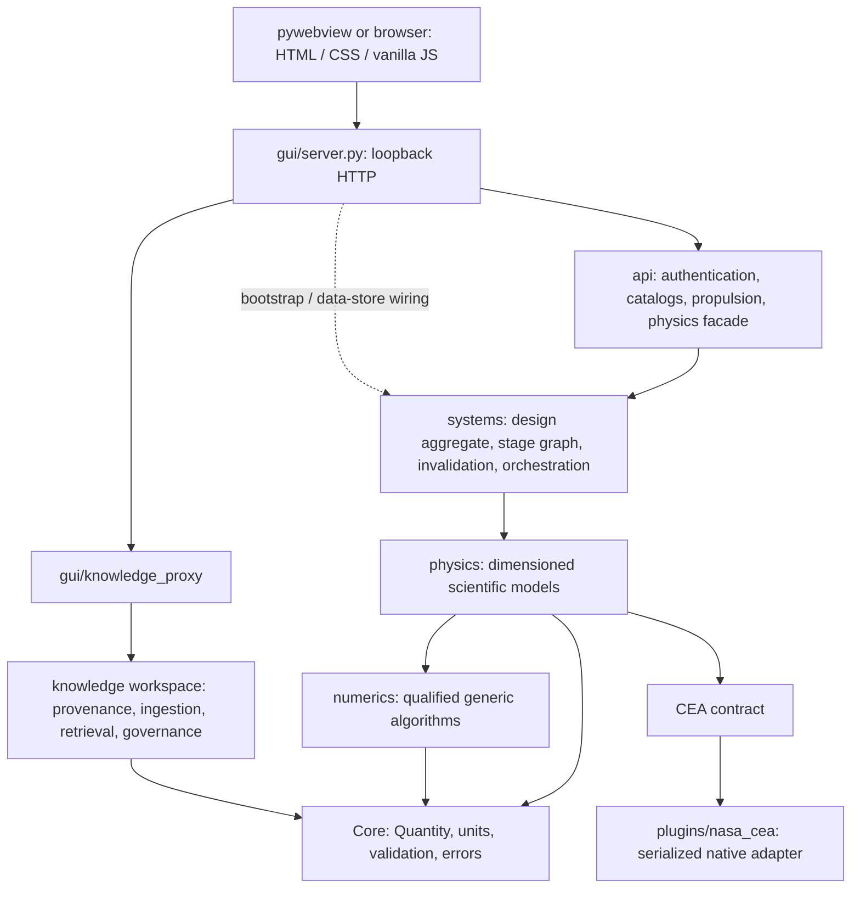

# P00 — Complete as-built repository and scientific engineering audit

Date: 2026-10-08. Reviewer: Codex, automated source/test/browser audit. Human engineering acceptance is not claimed.

## Decision

**G0: PASS for the bounded as-built audit. P01: READY for experience-architecture planning and workflow prototypes.**

This decision does not pass G1–G9. It does not authorize a framework migration, frozen-architecture amendment, PicoGK production integration, new physics models, or a release. The identified deficiencies are inputs to the gated plan, not reasons to conceal existing capabilities. No production source was changed during P00.

COSMOS has a substantial, tested preliminary rocket-engine workflow and a governed Knowledge workspace. It does not yet have the proposed NGG, operational Simulation or Comparison/V&V workbenches, a general CAD kernel, or a durable solver-job service. The existing native NASA CEA integration works in the audited working tree. A generated engine design is not thereby physically validated, safe to manufacture, or ready for hot-fire testing.

## 1. Authority, identity and scope

Repository root for every source path below:

`/Users/vaibhavkumarn/Desktop/COSMOS/COSMOS_0.1`

| Item | Verified value |
|---|---|
| Remote | `https://github.com/COSMOS-PVT-LTD/COSMOS-0.1.git` |
| Branch / local HEAD | `main` / `293223ebef190eaa647e67dc581eb186b2b5d987` |
| Live remote HEAD/main | Same SHA at audit capture |
| Working-source fingerprint | `117eaaeae0d56255fc6de4d55f65127d14147b05299c631880b297fc47a53a54` |
| Fingerprinted files | 1,467 tracked plus nonignored untracked files; P00 evidence excluded |
| Python inventory | 1,017 modules, including tests/tools; zero AST parse errors |
| Specification package | All 46 manifest-listed files read; zero SHA-256 manifest mismatches |
| Environment | macOS 26.5.2, arm64, Python 3.11.4, NumPy 2.4.6, CEA 3.3.4 |

The checkout already contained substantial modified and untracked production code. Therefore the tested baseline is **HEAD plus the fingerprinted working tree**, not a clean checkout of HEAD. `repository_baseline.json` records the original Git status and installed distributions. `source_hashes.json` makes this qualification reproducible. The original fingerprinted files remained unchanged during P00; the evidence directory is the only addition from this phase. No commit, push, merge, or hosted CI run was performed.

The audit began with `00_START_HERE.md`, `01_MASTER_CODEX_PROMPT.md` and `02_EXECUTION_SEQUENCE.md`, then read the complete specification package. The frozen design source is `documentation/COSMOS_0.1_FREEZED_ARCHITECTURE_export.pdf` (95 pages). All text was extracted and pages 1, 22 and 35 were rendered and inspected. The pack is a requirement source, not proof that its described modules exist.

Tests ran against an isolated copy of the fingerprinted source. Browser checks used a separate loopback server and temporary application-data directory on port 8790. The user's existing port-8787 session and saved projects were not used or changed. Browser scenarios used synthetic audit fixtures. The full inventory, direct-import edges, logs, screenshots and diagnostic probes are retained alongside this report.

## 2. Actual architecture and frozen-design deltas

Direct AST imports found no forbidden upwards imports from Core, Numerics or Physics under the audited policy. Existing architecture tests also passed. This is evidence for static imports; it is not a proof about every dynamic import or runtime extension.

| Root | Python modules / source files | As-built ownership |
|---|---:|---|
| `core/` | 17 / 17 | Canonical units, quantities, validation, exceptions, serialization |
| `knowledge/` | 412 / 418 | Governed source models, ingestion, storage, retrieval, workspace |
| `physics/` | 110 / 121 | Thermochemistry, fluid/compressible flow, heat transfer, injector hydraulics, materials/mechanics |
| `numerics/` | 140 / 145 | Generic algorithms and result contracts; 13 explicitly deferred metadata modules |
| `systems/` | 44 / 44 | Rocket design state, stages, dependencies, persistence, assembly |
| `gui/` | 8 / 52 | Native launcher, HTTP shell, static frontend, workbench registry |
| `api/` | 7 / 7 | Dictionary-based HTTP/application facades, typed lower-layer adapters |
| `plugins/` | 4 / 5 | Optional NASA CEA integration |
| `infrastructure/` | 5 / 5 | Paths, logging, credential storage |
| `tests/` | 263 / 284 | Unit, integration, regression, benchmark and verification fixtures |

The top-level roots `engineering/`, `simulation/`, `optimization/`, `ai/`, `visualization/`, `io/`, `validation/`, `projects/`, `governance/` and `external/` are absent in this snapshot. `databases/` exists but is empty. The plural `simulations/` output/artifact location must not be mistaken for the frozen `simulation/` solver package. Several corresponding responsibilities already live inside other working modules; absence of a proposed root does not mean absence of all related behavior.

### Architecture delta register

| Delta | Evidence and disposition |
|---|---|
| Frozen PDF/pack use Engineering; current code uses Systems | PDF pp. 22–26; `systems/`; `documentation/development/COSMOS_NUMERICS_FOUNDATION_ARCHITECTURE_001.md`. Keep the functioning Systems boundary. Obtain an approved ADR before relocation or a new Engineering service boundary. Do not build duplicate engines under a second root. |
| Several frozen packages remain future scope | Inventory above. Use additive interfaces and phase gates; do not create empty packages merely to resemble the diagram. |
| GUI is not a general dock/3D workstation | `gui/static/`, `gui/native_window.py`, PDF pp. 35–40. Preserve the current launcher/API; add a flagged shell only after G1/G2. A React/Qt migration is not justified by this audit. |
| Server performs bootstrap/store wiring | `gui/server.py` imports persistence/infrastructure in addition to API facades. Treat this as existing application-composition wiring, not a scientific solver in the frontend. New adapters should not expand algorithm ownership into GUI. |
| Historical baseline/waiver documents predate current numerics and CEA | `documentation/development/core_physics_frozen_baseline_001.md`, `physics/contracts/PHYS-004-NUM-WAIVER.md`. Preserve their historical record. Current code and executed evidence supersede them as implementation status, not as authority to amend architecture. |
| Existing databases are distributed | Physics propellant JSON and Knowledge registries exist. Core remains the canonical computation-unit authority. Define provenance/adapter ownership before a centralized catalog service; do not silently substitute Knowledge metadata for solver data. |

## 3. Workbenches and implemented engineering journey

Exact registry: `gui/workbenches/registry.py`. Machine inventory: `workbench_inventory.json`.

| Workbench | Route suffix under `/app/workbench/` | Implementation |
|---|---|---|
| Rocket Engine | `rocket-engine` | Active, preliminary workflow plus physics tools; scientifically partial |
| Knowledge | `knowledge` | Active governed source workspace; empty state exercised |
| Turbopumps | `turbopumps` | Planned tile/shared detail page; no operational workbench |
| PID | `pid` | Planned |
| Structures | `structures` | Planned standalone workbench; some thin-wall rocket checks already exist |
| Rocket Staging | `rocket-staging` | Planned |
| Manufacturing | `manufacturing` | Planned |
| Simulation | `simulation` | Planned; no study/mesh/run workspace |
| Visualization | `visualization` | Planned standalone workbench |
| Documentation | `documentation` | Planned; existing export/help are not this workbench |
| Code Comparison | `code-comparison` | Planned; not scientific Comparison/V&V |
| PLM | `plm` | Planned; local design persistence is not full PLM |

NGG is not registered. Login, workbench hub, administrator/audit/help views are application screens, not extra engineering workbenches. Planned routes use `gui/static/workbench/detail.html`. The hub labels planned status, but the visited Simulation detail page did not repeat a prominent “not implemented” notice. The legacy compressible-flow route remains available via redirect to the Rocket/nozzle flow.

Rocket stage truth source: `gui/workbenches/propulsion_suite.py`, `api/catalogs.py:list_workflow_catalog`, `systems/workflow/graph.py`. The 17-stage inventory and edges are in `workflow_inventory.json`:

| Stage maturity | Stages |
|---|---|
| Implemented workflow functions | requirements; propellants; operating_point; performance_summary; consistency; design_review |
| Partial scientific/design functions | design_project; thermochemistry; performance; injector; chamber; thermal; cooling; nozzle; structure; materials |
| Not implemented | cycle |

“Implemented” here describes the scoped workflow function, not a validated rocket subsystem. Cycle bypass permits preliminary calculations with an explicit limitation. `design_review` is a programmatic workflow check, not independent engineering approval or certification. `systems/workflow/orchestrator.py:103-255` assembles Phase 3, Phase 4, subsystem and Phase 6 runs. Recalculation and invalidation exist and must be reused.

## 4. Scientific computing and model maturity

The detailed, symbol-level matrix is `AS_BUILT_CAPABILITY_MATRIX.csv`; all Python paths/symbol ranges and content hashes are in `source_inventory.csv`.

### Core and result integrity

`core/quantity.py:61-366` and the unit/validation modules provide immutable, dimensioned quantities, affine-temperature handling, finite/positive guards and canonical serialization. These are reuse foundations, not targets for a UI rewrite.

`systems/contracts/results.py:25-240` distinguishes result status, validity, verification, validation and provenance. Physical validation defaults to **not claimed**. `CURRENT` means current with respect to the workflow, not verified, validated or safe. Frontend result rendering exposes structured statuses and errors.

There is a publication-boundary gap: `CalculationResult.inputs`/`outputs` and the active design aggregate remain mutable. In contrast, qualified numerical results use frozen contracts and some NumPy outputs are explicitly read-only. A blanket statement that all result arrays are mutable would be incorrect. Preserve editable working state, and add a separate immutable published snapshot/artifact contract under GOV-003.

### Physics and rocket engineering

| Capability | Evidence | Qualification / limitation |
|---|---|---|
| Ideal thermodynamics and equation-of-state helpers | `physics/thermodynamics/`, `physics/thermochemistry/` | Unit-aware algebra and qualified ranges; not a general cryogenic multiphase fluid engine |
| NASA polynomial/species and CEA contract | `physics/thermochemistry/cea_interface.py:62-151`, species/polynomial modules | Explicit request/result boundary and reactant-temperature limits |
| Native NASA CEA | `plugins/nasa_cea/engine.py:62-243` | CEA 3.3.4, database hashes/version, equilibrium/frozen values, serialized native calls. Three native-vs-legacy Fortran reference cases passed. This is code/reference agreement, not experimental validation. |
| Compressible flow | `physics/compressible_flow/` | Choking, area–Mach inversion, shocks, Prandtl–Meyer, Fanno/Rayleigh and nozzle/thrust relations. Canonical Numerics port; no silent fallback. Model assumptions still govern use. |
| Detailed divergent bell contour / stations | `physics/compressible_flow/bell_nozzle.py:72-172`, `physics/compressible_flow/external_nozzle.py:28-44` | Analytic/tangent contour and quasi-1D stations, with separate CEA exit-performance scaling. Coordinate export exists; no CAD solid, topology QA, general MOC contour or optimized Rao solution is proven. |
| MOC nozzle | `physics/compressible_flow/moc_nozzle.py:106-113` | Some invariants exist; contour generation deliberately rejects insufficient data. Do not present it as a implemented contour generator. |
| Injector sizing | `physics/injectors/orifice.py:84-115`, `systems/stages/subsystems.py` | Liquid-orifice hydraulics with explicit coefficient and pressure drop. No demonstrated atomization, spray interaction or combustion-stability prediction. |
| Regenerative cooling | `physics/heat_transfer/regenerative.py:146-315` | Single-phase divergent-nozzle channel model, constant-property assumptions, Reynolds/Prandtl validity checks and balance diagnostics. No boiling/critical heat flux/full chamber coupled model. |
| Film cooling | `physics/heat_transfer/film_cooling.py:53-100` | Qualified gaseous slot-film correlation. Not liquid evaporation or general combustor film physics. |
| Heat transfer | `physics/heat_transfer/` | Bartz/throat estimate, resistance, radiation and lumped/1D foundations; not CFD conjugate heat transfer |
| Materials and structures | `physics/materials/catalog.py`, `physics/solid_mechanics/stress.py`, `systems/stages/structure.py` | Handbook/property windows and preliminary thin-wall checks. Not certified allowables, general FEA, fatigue/creep life qualification or a manufacturing release. |
| Cycle balance | Stage graph/catalog and explicit NOT_IMPLEMENTED result | Not implemented. Do not infer turbomachinery power closure from successful thermochemistry. |

CEA exit performance is not equivalent to the constant-chamber-gamma quasi-1D contour field. Current CEA values must not silently become substitute coolant properties. Reactant enthalpy support is bounded around tabulated reference behavior, not a general heated-liquid equation of state. Existing fail-closed `InsufficientDataError`/unsupported-model behavior is a strength to preserve.

### Numerics

The source contains qualified generic roots, linear algebra, interpolation, quadrature, nonlinear methods, finite differences, 1D finite volume/FEM/PDE, ODE integration, mesh helpers, forward differentiation, gradient/BFGS optimization, local sensitivity, seeded uncertainty utilities, parallel mapping and result/history contracts. Examples include `numerics/pde/poisson.py:27-54`, `numerics/finite_volume/fv_solver.py:40-64`, and finite-element assembly/solve modules.

Thirteen modules are explicitly **DEFERRED metadata**, not operational solvers: reverse differentiation/Hessians; Bayesian, genetic, L-BFGS, multi-objective, Nelder–Mead, particle-swarm and simulated-annealing optimization; global/Morris/Sobol sensitivity; polynomial chaos. Their exact paths are in `repository_baseline.json`. Deferred modules and package exports are tested for honest capability state.

Fourteen three-resolution refinement studies and five repeated microbenchmarks were run. Their small analytic fixtures qualify those algorithms and convergence behavior, not a general 3D CFD/FEA application, arbitrary meshes, rocket optimization or large-model performance. A top-level Engineering optimization/AI workbench is absent.

### Geometry, simulation and scientific visualization

Current geometry is analytic nozzle/chamber dimensions, parametric-curve sampling, station/profile data and CSV export. No PicoGK production binding, versioned NGG graph, immutable geometry artifact service, coordinate-frame contract, independently checked manifold solid, B-rep adapter, CAD reimport or export-acceptance report was found. .NET 8.0.100 being installed does not establish PicoGK compatibility, licensing or packaging readiness.

Generic Numerics PDE/FEM/FV kernels must not be confused with a Simulation product. There is no operational geometry→mesh→study→solver→results pipeline, bounded process queue, solver cancellation/worker-crash contract, conservation dashboard or independent simulation V&V workspace. The registry/route are planned placeholders.

The frontend has CEA station tables, SVG nozzle/cooling profiles and a Knowledge graph. `gui/static/propulsion-suite.js:1284-1340` labels profile axes/units, provides a cooling legend and gates CSV export against current result identity and unsaved edits. Reuse these safeguards. These plots lack a general field viewer, scalar-range/clipping/colormap controls, residual definitions, and mesh/solution provenance inspection. Knowledge graph layout is not scientific field visualization.

## 5. Knowledge, provenance and verification infrastructure

The Knowledge package is broad and real: foundation/document/source models, engineering metadata, governed review, unit validation, parsers, source vaults, hybrid/graph retrieval, persistent indexes, embeddings, RAG provider boundaries and conversation services.

Key reusable boundaries include `knowledge/storage/local_store.py:LocalKnowledgeStore`, `knowledge/source/vault.py`, `knowledge/workspace/vault.py:DurableArtifactVault`, `knowledge/workspace/security.py:36-71`, `knowledge/workspace/jobs.py`, and `knowledge/production/local_rag_pipeline.py:55-214`. Content hashes, original/derivative records, versioned manifests, integrity verification and evidence-aware answer policy are useful design precedents. Reuse their concepts through deliberate interfaces; do not make scientific geometry ownership a side effect of a document/RAG subsystem.

The fresh empty-workspace browser query correctly returned no approved evidence and an `INSUFFICIENT_EVIDENCE` candidate rather than invented cooling citations or values. A local job/checkpoint store exists in Knowledge, but it is not a general asynchronous scientific process runner. No external model/provider was configured in the temporary audit workspace.

Current testing separates unit, integration, regression, benchmark and `validation_tests`. The latter 19 tests contain analytic/code/solution checks; their directory name does not demonstrate experimental engine validation. No qualified hot-fire dataset or experiment-to-simulation acceptance was established by this audit. Five Knowledge hashability tests are explicitly skipped pending nested immutable models. Store that as a known limitation, not a silent pass.

## 6. Persistence, state and execution gaps

### Confirmed isolated lost-update probe

`systems/persistence/design_store.py:16-79` writes one latest JSON file per design using a lock and atomic replacement. `api/propulsion_workflow.py:139-185` validates edits and checks `base_revision` against the aggregate passed to it. This correctly rejects many stale edits after a fresh load.

However, loading two aggregates before either save, then saving each with its own revision 0, allowed the second save to overwrite the first writer's saved draft. The API guard passed against the second loaded revision-0 object; the persisted revision was not checked and swapped atomically with the complete load–edit–save transaction. This was reproduced in a temporary store, not in user projects. A simultaneous HTTP race is inferred from the server's separate load/save sequence; it was not stress-tested.

`diagnostic_probes.json` contains the minimal probe and outcome. Add storage-level compare-and-swap/transaction semantics before trusted multi-view or worker updates. Do not remove the existing API edit guard.

### Revision and artifact lineage

`systems/projects/models.py:88-301` maintains revisions and a change log. These are not complete immutable revision snapshots or a checkout of older geometry/run inputs. Workflow results are keyed by stage and retain the latest envelope; there is no immutable published scientific run history with hashes across design→geometry→mesh→solver→export. GOV-003 and UX-005 are therefore incomplete.

The global “project” context in `gui/static/engineering-ux.js:48-61` is a localStorage name/system/component preference. It is not an authoritative versioned project service and is not the same identifier as `PropulsionDesign.design_id`. P01 must make that distinction understandable; P04/P06 must define the durable ownership contract.

CEA calls run synchronously on request threads; a native lock serializes calls. Browser requests have a timeout/abort mechanism, but aborting a fetch does not cancel a native calculation. `ThreadingHTTPServer` provides concurrent request handling, not bounded scientific process isolation, progress, cancellation or crash recovery. Current “Jobs”/“Solver” console summaries derive frontend/design state; they are not a durable job ledger.

## 7. Security, deployment and maintenance review

This is a source review and limited local diagnostic, not a penetration test.

Strengths: loopback default, salted PBKDF2 password storage, signed/session-expiry logic, RBAC/audit tests, HttpOnly/SameSite session cookies, path checks, typed scientific errors, and atomic local persistence. Preserve these.

Release blockers to plan explicitly:

- `api/authentication.py:135-146` creates a known development bootstrap administrator, and the login screen advertises its credentials. `--host` permits non-loopback binding. Require first-run credential rotation and an explicit network-exposure policy before nonlocal use.
- `api/authentication.py:79-85` writes the signing-secret file without an explicit restrictive mode. The isolated file was 0644; the temporary parent was 0700. That parent mitigates the audit instance, but does not prove normal deployment permissions. Never publish secret contents in evidence.
- `infrastructure/security/credential_vault.py` implements an unauthenticated bespoke XOR-mask storage scheme. Require security review and an OS keychain or a vetted authenticated-encryption design before production credential claims.
- `gui/server.py:169-175` and `_read_multipart_upload:1125-1166` read the declared body before an ingress-size limit. The Knowledge 100 MB check occurs after bytes are loaded. Review content type, bounded reads, parser isolation and malicious-upload behavior. No explicit Host/Origin/CSRF guard was found in the handler; SameSite mitigations are not a complete security assessment.
- `gui/static/cosmos-tokens.css:6` fetches Google Fonts. Offline operation, typography/Greek-symbol fallback and dependency/license closure need testing/bundled-asset assessment.
- Existing `dist/COSMOS 0.1.app` has a valid plist but fails strict signature verification as unsigned. The launcher depends on an absolute checkout/venv path. No self-contained, signed/notarized or cross-platform package was qualified during P00.
- CI source covers Python 3.11/3.12 and native CEA on Ubuntu, with JS/lint/type checks. Hosted CI for this dirty working tree was not run. The release workflow is a tag/check gate, not proof of deployment. Full lockfiles, native dependency/SBOM/license closure, supported-platform matrix and rollback are not demonstrated.

No third-party kernel was installed or copied for this audit. P02 must independently verify source provenance, license/IP constraints, runtime compatibility and redistributability before any production link.

## 8. Reuse and implementation constraints

| Preserve/reuse | Extension seam |
|---|---|
| Core Quantity/Unit/serialization/errors | Display adapters must not redefine solver units or hide conversions |
| Numerics port, termination/history/refinement fixtures | New worker diagnostics adapt existing contracts; do not invent a second solver library |
| Physics and native CEA contracts / negative tests | UI-only modernization with parity fixtures; scientific changes require separate approval |
| Systems stage DAG/invalidation/structured result envelope | New shell consumes existing API; publication/CAS added around editable aggregates |
| Workbench registry, login/RBAC, help/redirects, API client | Flagged navigation and rollback; preserve working deep links |
| Tokens, field/select/card/result renderers, command palette, dialogs/toasts | Consolidate into shared semantic components without premature framework replacement |
| SVG profile units/export-current guards | Geometry viewers must retain representation, tolerance, revision and export eligibility |
| Knowledge source vault/manifest/evidence policies | Source inspection and report UI; geometry artifact ownership remains explicit |

## 9. Prioritized findings and disposition

| ID | Severity / impact | Evidence | Required phase |
|---|---|---|---|
| F01 | High: lost edits under stale preloaded writers | API+DesignStore isolated probe; no storage CAS | P04/P06 before worker/multi-view writes |
| F02 | High: no immutable published lineage | Mutable result probe; latest-file store / stage-keyed results | P06; G5/G7/G8 prerequisites |
| F03 | High: kernel/simulation/V&V capabilities absent | Inventory, route/registry, Screenshot 08 | P02/P06–P10; fail closed meanwhile |
| F04 | High for release: security/package evidence incomplete | Source review; unsigned-app diagnostic | P04/P11/P12; block G9 |
| F05 | Medium: required inputs/results/revision distributed across scroll contexts | Screenshots 03–07 and 12 | P01/P03–P05 |
| F06 | Medium: draft/current/verification distinctions not a global durable state model | Result contracts vs local project/jobs summaries | P01/P04/P06/P09 |
| F07 | Medium: accessibility/visual standards not qualified | Step audit, keyboard/viewport probes, token/DOM inspection | P03/P12 |
| F08 | Medium: architecture naming and historical documents disagree | Frozen PDF vs current Systems ownership | Proposed ADR before affected integration |
| F09 | Medium: Knowledge immutability incompleteness | Five explicit baseline skips | Focused contract remediation before relying on immutable Knowledge hashes |
| F10 | Low: direct benchmark script invocation fails without import path | Failed log, recovered module run | Document canonical module invocation; no P00 production fix |

## 10. G0 acceptance and next boundary

| Required G0 proof | Artifact / result |
|---|---|
| Pinned source and environment | `repository_baseline.json`, `source_hashes.json`; live local/remote SHA plus dirty-tree qualification |
| Exact code/capability inventory | `source_inventory.csv`, `import_edges.json`, `AS_BUILT_CAPABILITY_MATRIX.csv`, workbench/workflow inventories |
| Baseline tests | `P00_BASELINE_TESTS.md`, JUnit/logs; 2,234 Python and 23 JavaScript tests passed; five documented skips |
| Fresh UI evidence | `P00_UI_UX_AUDIT.md`; 12 current screenshots, DOM/keyboard/minimum-window records |
| Architecture map and deltas | Section 2 above; frozen PDF extraction/renders |
| Phased plan and dependencies | `P00_IMPLEMENTATION_PLAN.md`; proposed decisions and G1–G9 acceptance boundaries |
| Traceable decision | `EVIDENCE_REGISTER.json`, `G0_DECISION.json` |

Proceed only to P01 documentation/prototypes after this handoff. P02 feasibility is independently eligible after G0 under the specification sequence, but was not started in P00. Do not begin full production redesign or PicoGK implementation here. Any architecture amendment, external IP decision or destructive migration must receive the required approval before execution.
