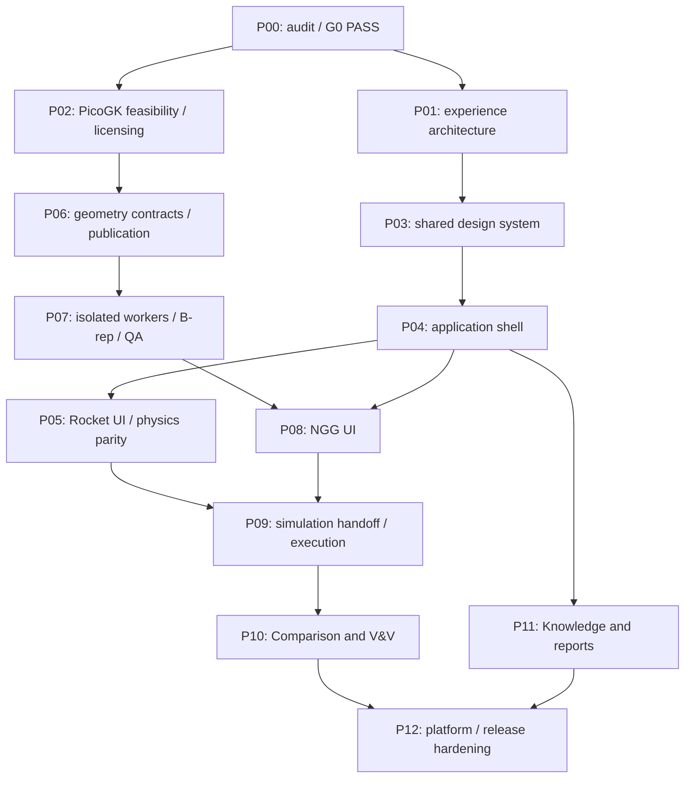

# P00 — Phased implementation plan and dependency graph

Status: proposed execution plan based on verified as-built code. It is not approval of an architecture amendment. Date: 2026-10-08.

## Baseline and nonnegotiable constraints

- Preserve the fingerprinted working tree and all functioning Core, Knowledge, Physics, Numerics, Systems, API and GUI modules. No automatic package move, framework migration or solver rewrite.
- Scientific behavior changes require separate approval and evidence. Keep SI internally, explicit conversions, model limits and no silent fallback.
- Keep execution, numerical termination, physical checks, verification and validation distinct. Never mark a planned feature operational or a software test physically validated.
- Working aggregates may remain editable. Published input/configuration/result/provenance/artifacts must become immutable and addressable; no overwrite of historical revisions.
- Tolerances come from intended use and independent references. Do not choose one global geometry tolerance or manufacture a validation dataset.
- Kernel/representation/licensing/runtime decisions must be verified before production linkage. No arbitrary implicit→editable parametric STEP claim.
- Run focused contract/negative tests for each scoped change, and the full regression suite at release gates. Keep evidence tied to SHA plus any dirty source fingerprint.

## Dependency graph (specification sequence, preserved)

P01 and P02 may proceed independently after G0. This graph describes scheduling dependencies, not permission to use subagents or to merge incomplete work. P04 shell and P06 publication must agree on a shared revision/CAS contract before any worker integration. P05 can modernize current preliminary calculations without implementing cycle power balance. P11 must not bypass the source/evidence policies.

## Phase slices, reuse seams and gates

| Phase | Scoped outputs | Existing seams to reuse | Required proof / stop condition |
|---|---|---|---|
| P01 Experience architecture | Current/future capability navigation; create/open/project identity; Rocket preflight/result inspection; Knowledge empty/source journey; NGG/Simulation/V&V prototypes; Guided/Standard/Expert density contracts | `gui/workbenches/registry.py`, stage catalog, current routes, 12 screenshot scenarios | **G1:** reviewed navigation flows/prototypes/review record. Stop for missing critical flow or unapproved ownership decision. No production redesign here. |
| P02 PicoGK feasibility | Isolated source/license/IP/runtime assessment; Mac arm64 proof; alternative representation/backend matrix; measured fixture resources; distribution constraints | Installed .NET/Fortran only as environment evidence; no current kernel adapter to reuse | Source/version/license register and reproducible nonproduction fixture. Stop on unclear rights, unsupported platform or unverified library compatibility. Do not link production. |
| P03 Design system | Consolidated semantic tokens; accessible Field/UnitInput/ScientificStatus/ResultCard/Table/Dialog/CommandPalette/Panel contracts; typography/contrast/zoom; screenshot tests | Existing tokens/styles and vanilla render helpers/palette/live regions | **G2:** states, keyboard/focus, visual and contrast checks at supported desktop sizes; plots retain quantity+unit. No fake solver status. |
| P04 Shell and project dashboard | Feature-flagged shell; existing deep-link access; authoritative context vs local preference; recoverable panel layouts; version/CAS foundation; first-run exposure policy | API auth/RBAC, registry, paths, existing launcher, current design save/invalidation | **G3:** all active workbenches accessible; flag-off rollback tested; stale-save rejection and context contract. Stop if current Rocket/Knowledge flows break. |
| P05 Rocket modernization | Workflow-guided required inputs; preflight and linked errors; compact CEA/station/model-limit views; structured results and assumption inspection | `api/propulsion_workflow.py`, Systems stages, CEA adapter, fixtures and unit guards | **G4:** baseline parity including NASA cases, negative temperatures, stale exports and explicit ambient-zero/missing distinction. No unauthorized physics/model default changes. |
| P06 Geometry/publication contracts | Immutable DesignSnapshot, typed graph/request/event/artifact/report/NamedSelection/SimulationHandoff; units/frames; hash-addressed revisions; storage CAS and schema migration plan | Core canonical serialization; result provenance; Systems revisions/invalidation; Knowledge manifest/vault patterns via deliberate interfaces | Contract round-trip, invalid units/frames, stale revision, sequence ordering, duplicate/idempotent event handling, immutable publication. No unapproved Engineering/Systems relocation. |
| P07 Geometry workers / B-rep | Python service→process protocol→C#→C++/OpenVDB adapter; separate analytic B-rep path; bounded resources; cancel/crash recovery; representation-aware exports and independent reimport | Existing analytic contour is an input/fixture, not an implicit CAD kernel | **G5:** analytic/implicit/faceted labels; dimensional/topology/hash checks; source/export tolerances separately recorded; independent reimport. No publish on failed/cancelled/QA-rejected job. |
| P08 NGG UI | Inputs/feature graph/build/inspect/export/reimport task; viewer adapters; capability-aware controls; immutable artifact inspector | Flagged shell and P06/P07 services; current scientific labels/export freshness checks | **G6:** end-to-end build→inspect→export→reimport, failure/cancellation, recovery and artifact evidence. No UI-owned geometry state or crash. |
| P09 Simulation | Immutable accepted geometry handoff; semantic selection mapping; materials/frames/mesh constraints; actual study backend adapter; progress/residual/conservation/termination views | Numerics contracts where appropriate; result validity/provenance dimensions; no existing study service | **G7:** honest backend capabilities; actual study run and conservation/convergence diagnostics; geometry mapping integrity. No success from a placeholder, no implicit physical-validation claim. |
| P10 Comparison and V&V | Versioned reference datasets, independent comparisons, uncertainty and error norms, explicit verification vs experimental validation, review disposition | Baseline analytic/refinement/CEA comparisons and source evidence | **G8:** traceable matched variables/units/frames/revisions and uncertainty; independent reference; declared tolerance policy. Block mismatched or absent data. |
| P11 Knowledge and reports | Accessible source/evidence inspector, upload/governance states, honest assistant affordances, reusable report rendering, bounded ingestion | Existing Knowledge pipeline/vault/index/RAG policy rather than a second knowledge engine | Source hashes/review policy survive; no invented citations or physics execution; bounded upload/parse and provenance tests. Address pending immutability deliberately. |
| P12 Hardening and release | Supported-platform CI; dependency pins/lock/SBOM/notices; cold startup/RSS/large-data budgets; worker sandboxing; credentials/request security; signed packages; backup/schema/flag rollback; documentation and independent signoff | Current CI/release/tag gates and build scripts with qualified extensions | **G9:** no open critical defect; clean-source reproducible CI, native platform checks, signing/distribution/rollback evidence. Missing target support blocks that target's release. |

## Proposed decisions that require review before affected implementation

These are recommendations, not approved ADRs. Use the pack's ADR template when the decision becomes actionable.

| Proposed ADR | Decision to resolve | Evidence / why it matters |
|---|---|---|
| A01 — Frozen ownership | Retain Systems scientific assembly; define approved adapter boundaries for future Engineering/Geometry/Simulation responsibilities | Renaming would invalidate imports/tests and risks duplicating ownership. Frozen PDF and present source naming differ. |
| A02 — Publication and transactional revisions | Storage CAS, immutable snapshots, project/design identity, schema version/migration/backup and historical result addressing | F01/F02 reproduced; every artifact/worker needs unambiguous input lineage. Reuse current edit guard and DAG. |
| A03 — Kernel/IP and representations | Supported PicoGK/runtime/version/license, analytic B-rep backend, explicit export capability per representation | No kernel is integrated. A mesh/faceted approximation is not a recovered parametric solid. Exact redistributability remains unverified. |
| A04 — Worker security/execution | Process protocol, resource limits, cancellation, crash recovery, event order, artifact publication rules | Synchronous request threads/native lock are not a background job service. Bounds and sandbox policy must precede native parser exposure. |
| A05 — Shell/viewer technology | Minimum-change renderer strategy, accessible docking, large-field viewer and supported-platform packaging | Current vanilla/pywebview works; no measured justification for replacing it. Compare alternatives with actual fixture/resource evidence. |
| A06 — Security/deployment | Local-only default vs deliberate network mode, bootstrap rotation, signing-key/vault storage and ingestion bounds | Known dev credential, file-mode behavior, unauthenticated bespoke vault and unsigned current app preclude a release claim. |

Approval is required for frozen-architecture amendments, destructive schema migrations, significant security-risk choices or explicit license/IP decisions. Routine additive tests/docs/components within an approved phase do not require repeated permission requests.

## Feature flags and rollback

Proposed flags from the specification: `COSMOS_NEW_SHELL`, `COSMOS_NGG`, `COSMOS_NEW_SIM_UI`, `COSMOS_NEW_VV_UI`. They are **not currently implemented**. P04 should define typed/configured evaluation and a tested flag-off path. Later flags should not cause unqualified backend operations to become enabled.

Rollback must restore old routes/components without silently rewriting immutable artifacts. Back up existing stores before any approved schema migration, test downgrade/read compatibility, and retain the current working GUI/API. Do not use destructive Git resets to achieve rollback.

## Numerical and UX acceptance fixtures to carry forward

- Full existing Python/JS baseline; five explicit Knowledge skips tracked separately.
- Three native/legacy CEA cases and NASA reference fixtures; model/database version and hash recorded.
- CEA input limits, missing ambient vs explicit vacuum, typed errors, failure/stale propagation and no fallback.
- Preliminary contour/cooling profile units, CSV freshness/identity and unsaved-input rejection.
- Load/edit/save CAS race, immutable old revisions and published result input mutation rejection at the new publication boundary.
- Existing deep links, registry maturity badges, project/design separation, minimum desktop, keyboard palette and actionable error navigation.
- Worker crash/timeout/cancel, invalid frame/unit, unsupported export, topology rejection, selection remap failure and independent reimport.
- Verification status remains independent of execution success; absent experimental/source evidence remains explicit.

## P01 entry decision

G0 evidence is complete and current. P01 is ready to document/prototype the real tasks, retain current routes and define the authoritative context/status model. P01 does not need to wait for the new kernel, but it must represent kernel-dependent flows as future/conditional capabilities. Complete G1 review before full production redesign. No P01, PicoGK, new physics, cycle-balance or release implementation was performed during P00.
