# P00 — UI/UX audit with fresh visual evidence

Date: 2026-10-08. Source identity and dirty-tree qualification: [repository/scientific audit](P00_AUDIT_REPORT.md). This report is an audit, not a redesigned interface or design approval.

## Scope and method

The Product Design audit workflow informed this report: evaluate the actual task journey, capture current screenshots, separate observed behavior from source-derived risks, and retain reusable strengths. No design preference was treated as a scientific requirement.

Tested: login, hub navigation, Rocket design creation/save, propellant/thermochemistry setup, native CEA success and failure, a planned Simulation route, Knowledge empty/search/chat states, command-palette keyboard behavior, and the native minimum desktop viewport. The account/store were isolated synthetic audit data. Screenshots are new evidence from port 8790, not earlier marketing images or the user's existing port-8787 session.

Primary viewport: 1280×720. Minimum: 1100×700, matching `gui/native_window.py`. The viewport override was reset after testing. Native pywebview was not launched. These results are not a mobile, screen-reader or full WCAG certification.

## Executive assessment

The interface is a useful engineering prototype with stronger scientific honesty than its visual hierarchy. It labels units, distinguishes stale/current/error states, requires explicit saves, exposes provenance and rejects unsupported calculations. Those behaviors should survive modernization.

The dominant usability cost is fragmented context: global navigation, workbench navigation, project preferences, design revision, input forms and structured results compete across nested scroll regions. Required inputs for one calculation are distributed across screens. Planned workbenches are easy to discover, but detail pages do not consistently explain that they are not operational. Current project/job indicators also look more authoritative than their local preference/derived-state implementation supports.

Priority is workflow clarity, durable context and accessible shared controls—not additional decoration or a premature framework replacement.

## Numbered journey and screenshot evidence

### 1. Login — healthy local flow; deployment caveat

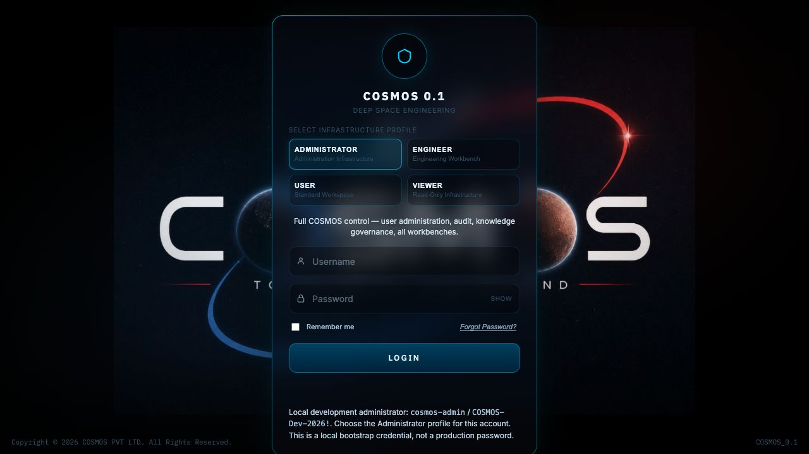

The login works and clearly shows the local-development account. Roles and access control exist. The branded background and faint small explanatory text make the supporting information harder to scan. More importantly, advertised bootstrap credentials are a development affordance, not an acceptable network-deployment default. Separate the P03 typography improvement from the P12/security first-run policy.

Evidence: `api/authentication.py`, `gui/static/login.html`, Screenshot 01. Only the administrator journey was exercised in-browser; RBAC is additionally covered by baseline tests.

### 2. Workbench hub — clear breadth; expensive navigation

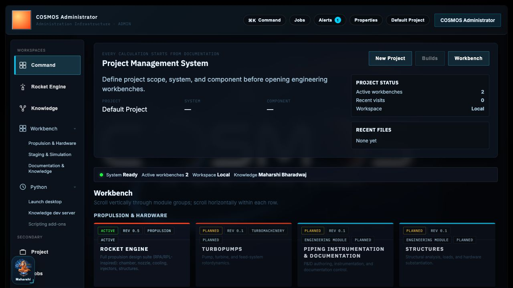

The registry-driven cards and planned badges communicate breadth. Rocket and Knowledge are the two active workbenches; ten others are planned. However, the large heading/context/card regions consume the initial viewport and push primary engineering actions below the fold. Multiple navigation axes increase scanning cost. The floating Maharshi panel overlaps part of the left navigation in this viewport.

P01 should organize by the real user journey and make operational/planned maturity discoverable without treating twelve tiles as twelve working products. Preserve routes and the registry. Replace overlap with recoverable, accessible docking only after G1/G2.

### 3. Empty Rocket workspace — useful explicit controls; overwhelming first task

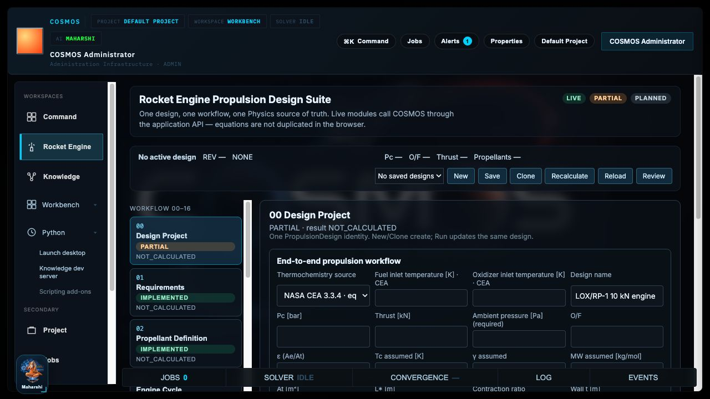

The stage sequence, physics tools and explicit New/Save/Recalculate actions are valuable. Seventeen workflow stages plus additional tools are exposed immediately, while no design is active. Mixed requirements/settings in the long initial form make it difficult to know the first necessary action. Some controls remain visible even when there is no active design, requiring contextual error handling.

The default design name is a template label, not evidence that propellants/cycle are configured. Use a clear create/open entry state, capability-aware controls and visible draft/configuration state. Guided/Standard/Expert modes may change density only; they must not change scientific defaults or validity limits.

### 4. Requirements saved — good units/save boundary; context disappears

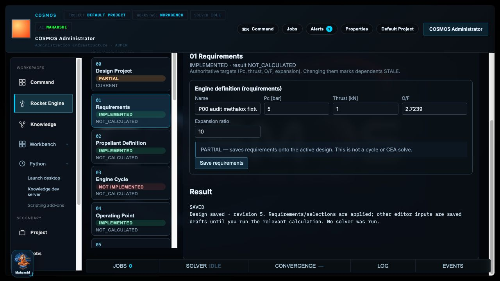

Fields show their units. Explicit saving preserves a meaningful draft-versus-saved boundary; no hidden automatic solver run was observed. The synthetic fixture saved pressure 5 bar, thrust 1 kN, O/F 2.7239 and expansion ratio 10. Multiple edited fields advanced the design revision; that number is not a single immutable publication identifier.

The active design/revision header moves outside the focused pane's visible context as the user scrolls. A long monospaced result summary competes with editable requirements. P01/P04 should preserve authoritative design/revision identity continuously and distinguish the browser's global project preference from the scientific design aggregate. Do not invent revision checkout in the UI before storage supports it.

### 5. First run fails on missing ambient pressure — scientifically honest; preventable late failure

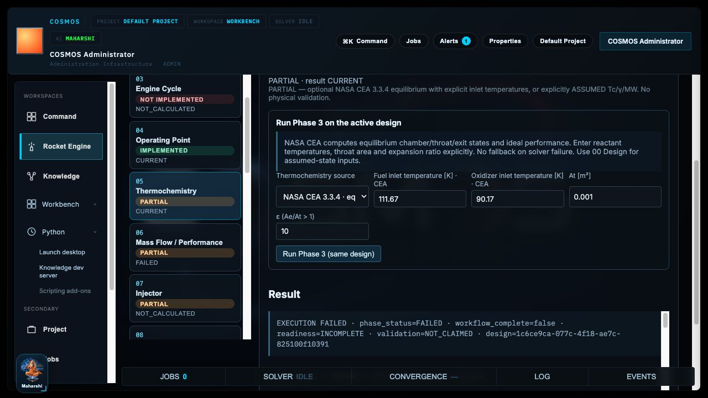

LOX/LCH4, inlet temperatures, throat area and expansion ratio were configured in the thermochemistry tool. Thermochemistry succeeded, but dependent performance failed because explicit ambient pressure had not been supplied on the other configuration screen. The system preserved a typed failure rather than treating a blank field as vacuum.

This is a strong scientific contract and a weak task flow. Add a preflight checklist using the existing API requirements, distinguish missing from zero, and provide an accessible jump to the exact missing field. Do not solve the UX issue with a silently chosen ambient-pressure default. Structured error details should be immediately visible next to the run summary.

### 6. Native CEA success — useful provenance/table; result hierarchy too long

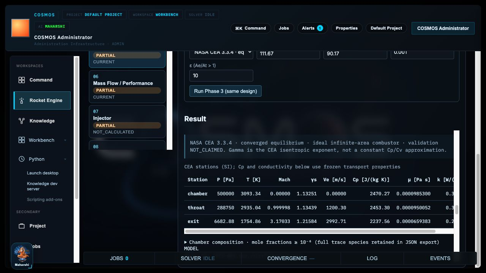

After saving ambient pressure 0 Pa, rerunning produced current native CEA thermochemistry and ideal exit performance. The chamber/throat/exit table provides ordered stations and unit headings. Provenance and nonphysical-validation notices are present. This is a functioning scientific result, not a placeholder.

Several success envelopes, assumptions and serialized details create a long nested result region. The conductivity columns overflow horizontally within the table. The primary engineering answer is harder to scan than the JSON-like detail. Use a concise summary, a persistent validity/verification strip, then inspectable station data, assumptions and provenance. Preserve complete machine-readable data for experts.

The global console showed Solver IDLE/Jobs 0 after the run. These are derived frontend indicators, not a durable completed-job ledger. Do not add cosmetic progress or history without a real execution contract.

### 7. Out-of-range temperature — correct fail-closed behavior; recovery can be more direct

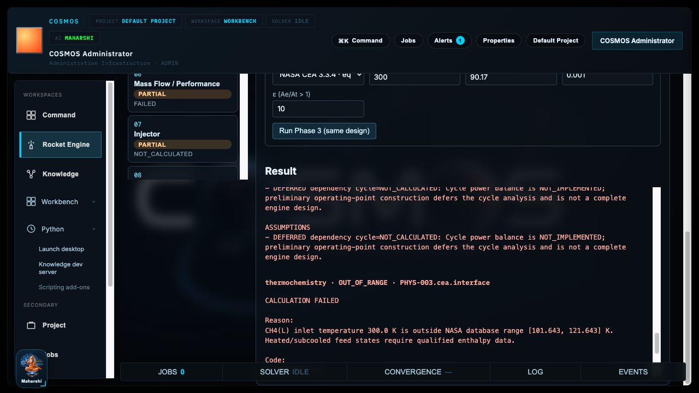

Setting the fuel temperature to 300 K produced an out-of-range thermochemistry result and a failed dependent performance result. Previous chamber-state values were cleared and dependent geometry was marked stale. No fallback or stale success table was presented as current. Preserve this behavior.

The technical cause and corrective text are deep in the result region. “Correct input” is less helpful than highlighting the temperature field and the model's permitted range with its source. Focus management and error-summary links should keep the user at the failing task instead of forcing scroll/search through envelopes. Do not broaden the physical model's validity to avoid an error message.

### 8. Simulation route — planned, not operational; detail-page maturity missing

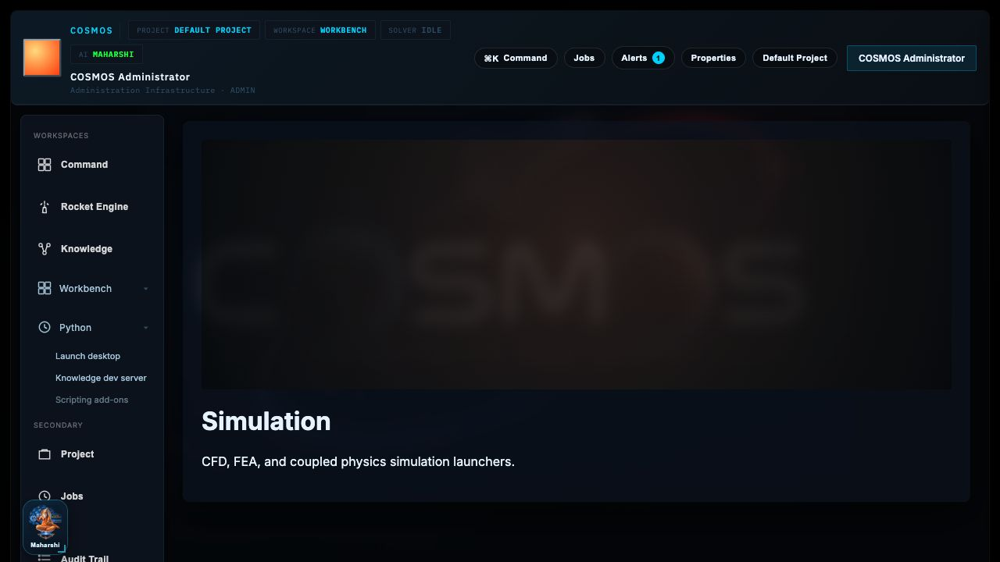

The route is reachable, but its fully loaded page contains a descriptive banner, not study setup, geometry handoff, mesh, solver configuration or results. The hub labels this tile planned. The detail page does not prominently repeat “planned / not implemented,” which makes the maturity ambiguous when reached directly.

Add truthful capability/roadmap copy in the future shell. Do not infer an operational Simulation product from generic Numerics kernels or this banner. NGG is not registered at all. Code Comparison is also not the proposed scientific Comparison/V&V workspace.

### 9. Empty Knowledge workspace — honest state; next action needs emphasis

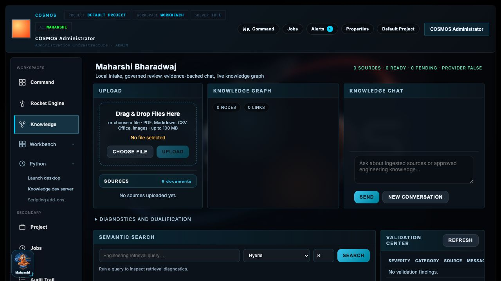

Zero ready sources, pending work and unconfigured provider state are exposed. Upload is appropriately disabled until a file is chosen. Source, search, validation, review and graph concepts are present. The empty graph and dense multi-column layout do not emphasize the simple next action: import and qualify a source.

Replace raw `provider FALSE`-style technical state with clear text such as “No provider configured,” without implying that a provider is mandatory for every local source workflow. Keep governance/evidence separate from calculated physical results. A guided empty-state action should explain supported files, size limits and approval states.

### 10. Search/chat without evidence — healthy nonfabrication; dense inspection surfaces

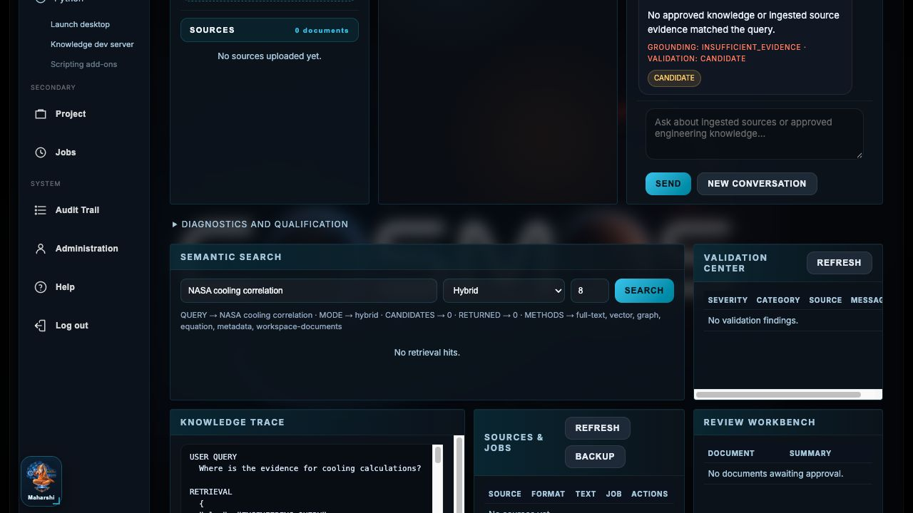

Searching for a NASA cooling correlation returned zero matches. Asking for cooling-calculation evidence returned no approved source match and an `INSUFFICIENT_EVIDENCE` candidate. No fabricated citations, calculation or validation claim was generated.

Tables and three-column sections become cramped; some validation data requires horizontal scrolling. Unlike parts of the Rocket view, global context moves out of view during long Knowledge scrolling. Prefer consistent source inspection and result-state components. The graph canvas needs an accessible semantic alternative and keyboard inspection assessment before claiming a keyboard-complete workspace.

### 11. Command palette keyboard — useful, working focus trap; limited restoration probe

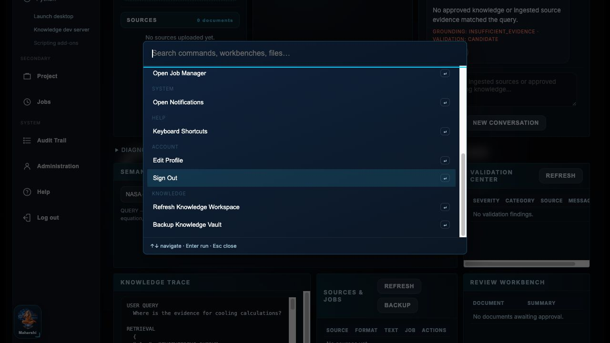

Ctrl+K opened the palette with focus in its search input. Shift+Tab wrapped to the last command; Tab wrapped back; Escape closed the dialog. In this probe the prior focus was the noninteractive body, so focus returned to BODY. This does **not** prove that trigger-button restoration is broken. Existing restoration code/tests should be preserved; assess a meaningful fallback for hotkey invocation from an unfocusable origin.

Command discovery and keyboard hints are strong reusable controls. The exact recorded sequence is `keyboard-observations.json`. Not every command or destructive modal was executed. A full keyboard-only scientific task remains a P03/P12 acceptance test.

### 12. Minimum desktop viewport — no outer horizontal overflow; dense vertical work area

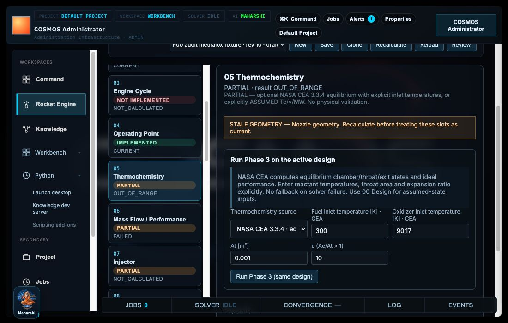

At 1100×700, `documentElement.scrollWidth` equaled `clientWidth` (1100): no outer horizontal overflow was observed. Form columns adapted and the header wrapped. That is a positive responsive baseline.

The stacked controls and headers still leave little room for data/results. Nested scrolling is more costly at the supported minimum. Several 9–12 px metadata/supporting-text styles warrant review. The captured form labels were 12 px and `rgb(159,179,200)`; they must not be misreported as all using the darker muted token.

The sample JSON records the first four inactive stage buttons without ARIA-current; this is expected and is not proof that the selected stage lacks an announcement. Source `gui/static/propulsion-suite.js:1787-1826` sets `aria-current="step"` for the active stage and `aria-current="page"` for the active tool. Preserve that existing behavior. All navigation buttons remain tab stops; assess grouping/keyboard ergonomics without changing semantics into an unsupported tab pattern.

## Design system, components and state management

Current implementation is HTML/CSS/vanilla JS, served locally and embedded by pywebview. There is an existing token vocabulary in `gui/static/cosmos-tokens.css`, shell styles and `cosmos.css`, alongside hardcoded/overlapping workbench styles in `propulsion-suite.css`. Consolidate semantics and precedence; do not discard working tokens or impose a new framework by default.

Reusable component/function seams:

- `gui/static/propulsion-suite.js`: `field` (593), `selectField` (604), `makeCard` (619), `renderStructuredPhase` (331), `appendCeaVisual` (390), `setResult` (431), `renderContextBar` (480), `renderBoard` (554), profile/export guard (1284 onward).
- `gui/static/engineering-ux.js`: command palette, global context/console, modal and keyboard affordances.
- API client: unit-bearing payloads, typed scientific error envelopes, request timeout handling.
- Existing CSS focus-visible rules, live status/toast announcements and reduced-motion handling for background effects.
- Registry-driven navigation, explicit draft saves, busy flags and result-generation guards against stale async renders.

State is spread across mutable JS workspace state, saved editor drafts, Systems result state and localStorage global preferences. There is no shared durable project/revision/artifact or cancellable job-state model. A client timeout does not cancel native CEA. Use adapter contracts to unify presentation while retaining authoritative server-side scientific state.

There is no general persistent SplitDock, shared UnitInput/ScientificStatus/JobMonitor contract library, display-unit preference system, Guided/Standard/Expert mode or scientific 3D viewer. The floating Maharshi interaction does not constitute a general engineering dock layout. These are future requirements, not reasons to delete the current shell.

## Accessibility and visual evidence limits

The opaque token pair `--cosmos-muted` / `--text-label` `#365570` against `--cosmos-panel` `#0A1220` has calculated contrast approximately **2.40:1**. If used for active normal text on that panel, it falls below WCAG's 4.5:1 normal-text threshold. Large text has a 3:1 threshold; inactive/decorative/logo exceptions apply. This is a **token-level risk**, not a measured failure for every element. Actual captured form labels use a brighter override. A rendered/composited DOM contrast audit remains necessary. [W3C contrast guidance](https://www.w3.org/WAI/WCAG22/Understanding/contrast-minimum.html).

Additional acceptance work: text/zoom scaling; screen-reader labels and live-region behavior under recalculation; all modal/floating-panel traps/restoration; graph/table alternatives; accessible destructive confirmations; high-contrast mode; reduced motion across graph/viewer animations; and absence of color-only scientific meanings. No WCAG compliance or comprehensive accessibility pass is claimed from these spot checks.

Scientific plot findings are specific: existing nozzle/cooling SVG plots **do** label metres/K and provide a cooling legend, and export rejects stale/dirty identity. They are not missing all axis units. They do lack a full generic field/residual viewer and inspection controls. Keep the existing scientific guardrails as acceptance fixtures.

No persisted visual-regression screenshot suite, large-table virtualization or performance-qualified large geometry viewer was found. These twelve screenshots are the P00 audit baseline, not an automated future regression suite.

## P01 priorities and acceptance scenarios

1. Model the honest journey: project/design → requirements → model/propellant selection → preflight → run → inspect validity/evidence → publish/export. Clearly branch planned geometry/simulation capabilities.
2. Keep authoritative project/design/revision and draft/stale state visible. Do not equate localStorage names with project identities or `CURRENT` with validation.
3. Put required inputs and failures within the active task. Include a missing-input checklist and field-linked recovery without hidden defaults.
4. Define a concise engineering result view with expandable raw/provenance data. Preserve table units, station order, freshness and failed-result policy.
5. Design resizable/collapsible/recoverable panels and accessible command/navigation patterns. Validate at 1100×700 and larger screens with keyboard-only workflows.
6. Prototype honest planned states and publication/job histories only against agreed data contracts. Modes change density, never solver models or tolerances.

G1 needs reviewed flows/prototypes and a review record. G2/G3 require implemented components, accessibility/visual checks and rollback. This report satisfies visual audit evidence for G0; it does not pass those later gates.
