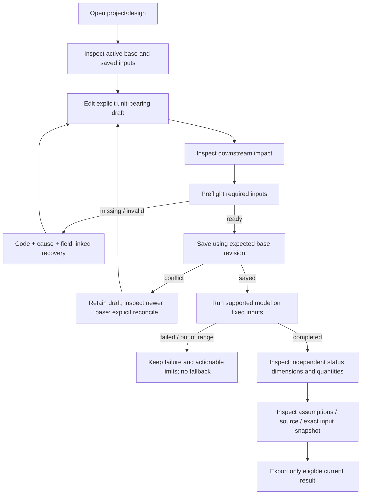
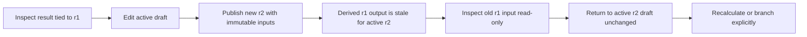
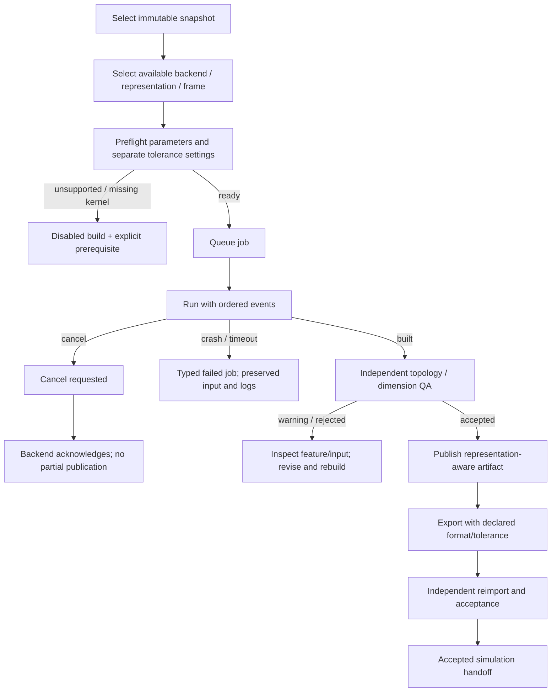
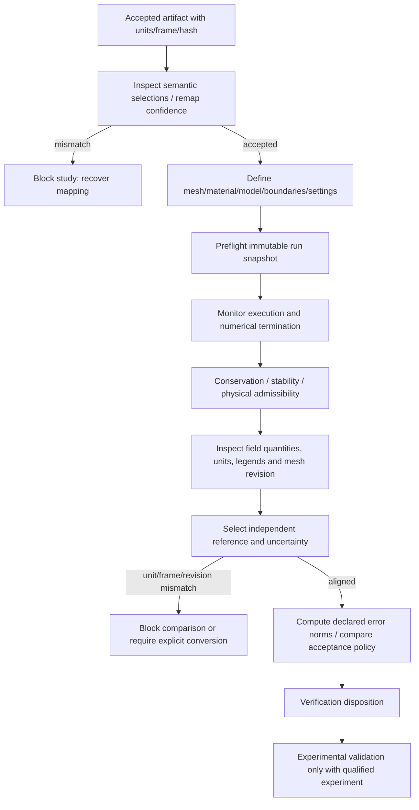
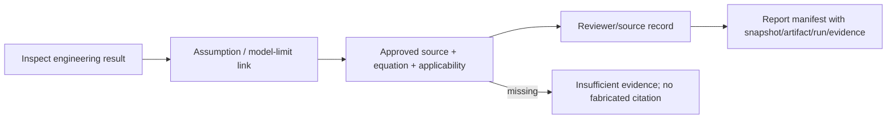

# P01 — Personas, task journeys and negative paths

These are task-based design personas inferred from the product specification and audited software. They are not interview findings or completed user studies.

## Personas and outcomes

| Persona | Main tasks | Critical trust need |
|---|---|---|
| Propulsion analyst | Configure propellants/operating point; preflight; inspect CEA/performance and supported subsystem estimates | Explicit units/model limits and reproducible input identity |
| Geometry engineer | Select representation; build from snapshot; inspect topology/dimensions; export/reimport | Tolerance, coordinate frame, approximation and artifact lineage |
| Simulation engineer | Accept geometry/selections; configure study; monitor convergence/conservation; inspect fields | No mismatched geometry/mesh/revision or false numerical success |
| Independent reviewer | Align reference data/uncertainty; review assumptions and evidence; disposition | Separate verification, experimental validation and execution |
| Knowledge curator | Import/source/review documents; inspect citations and applicability | Original hashes, approval status and no fabricated sources |
| Project/release owner | Choose context, review history, permissions, reports and rollback | Durable identity, explicit acceptance and supported-platform evidence |

## Journey A — Existing supported Rocket calculation

Acceptance: open existing data without migration loss; units visible; blank ambient rejected but explicit zero accepted; mode switching cannot alter the model; failed CEA/unsupported cycle stays honest; dirty/stale output cannot be exported as current. P01 demonstrates only synthetic input/state navigation. Real API parity remains G4.

## Journey B — Revision iteration without data loss

Inspection and activation are distinct operations. Never overwrite the active draft when a user opens historical evidence. A future “branch from r1” creates a new revision with explicit source lineage; it does not relabel old outputs current. P00 found latest-only persistence and a stale-writer race. This journey cannot be enabled in production before P04/P06 publication/CAS contracts.

## Journey C — Geometry and failure-aware handoff (planned)

P01 provides scripted queued/running/QA/rejected/cancellation examples. No real geometry, CAD export or reimport exists in the prototype. Failed/cancelled/rejected states cannot publish a real artifact. A tessellated/faceted export must not be labeled editable parametric CAD.

## Journey D — Simulation and independent V&V (planned)

A nonconverged solver run is not numerical success. A missing reference cannot produce a verification/validation pass. Model/tolerance defaults must not depend on UI mode. P01 shows these prerequisites and unavailable states without inventing numerical plots or study outputs.

## Journey E — Claim to source / report

Knowledge curation is separate from physics execution. Import/parser/provider configuration cannot silently certify an engineering result. Reports must disclose absent evidence and not infer approval from an assistant answer.

## Scripted review tasks

1. Open the example project. Run required-input preflight. Follow the ambient-pressure recovery link. Enter 0 Pa explicitly and confirm readiness.
2. Show a completed fixture. Edit chamber pressure to 600,000 Pa, save a new example revision, then inspect demo-r1 from history. Confirm active r2 and old r1 inspection are both visible and r1 evidence remains stale for r2.
3. Switch Guided/Standard/Expert and all primary workbenches. Confirm exact input values and draft/base identity remain unchanged.
4. In planned NGG, start a scripted job, advance to QA, inspect/reject its warning. Start another, request cancellation and wait for explicit acknowledgement. Confirm real build/export stay unavailable.
5. Inspect Simulation and V&V prerequisites. Open Knowledge and check a query with no source. Confirm missing evidence and no fabricated result/claim.
6. Use the command palette by keyboard, restore layout, and cancel a reset confirmation. Confirm focus restoration and no draft loss.

These scripts are for owner/internal user review. Automated prototype execution is not a user-study completion record. Production migration and full end-to-end scientific tests remain separate gates.
