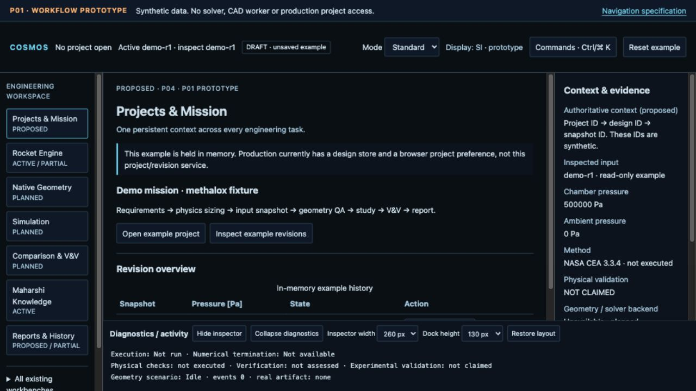
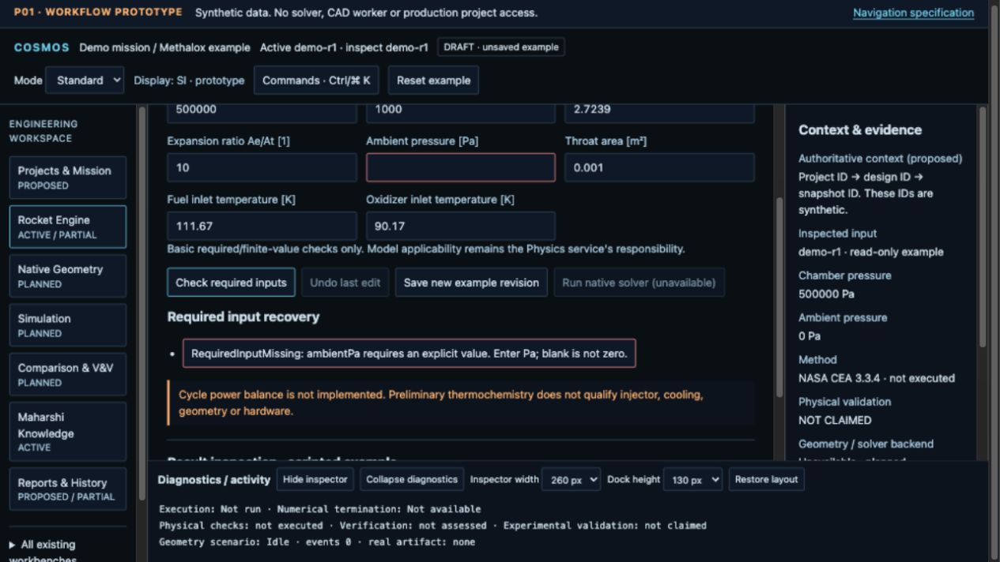
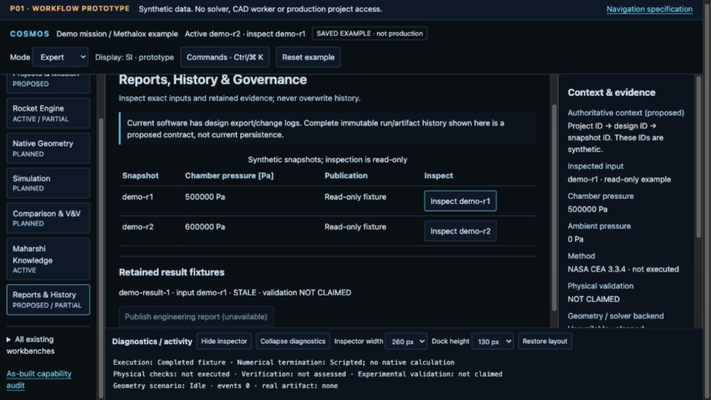
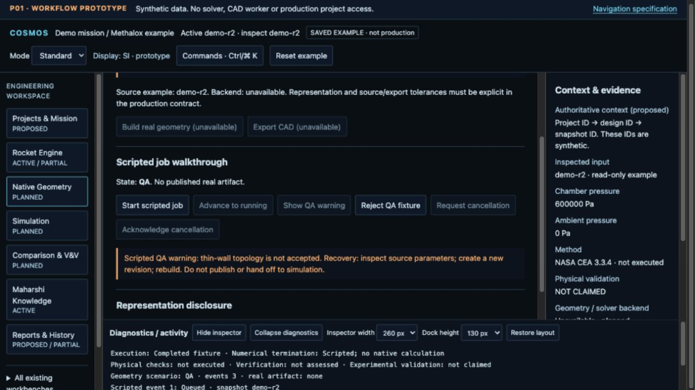
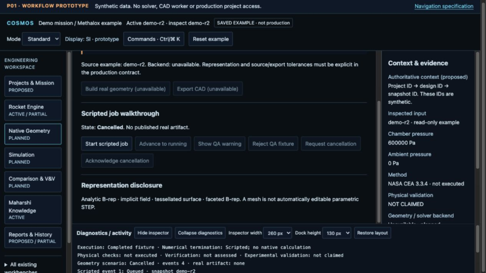
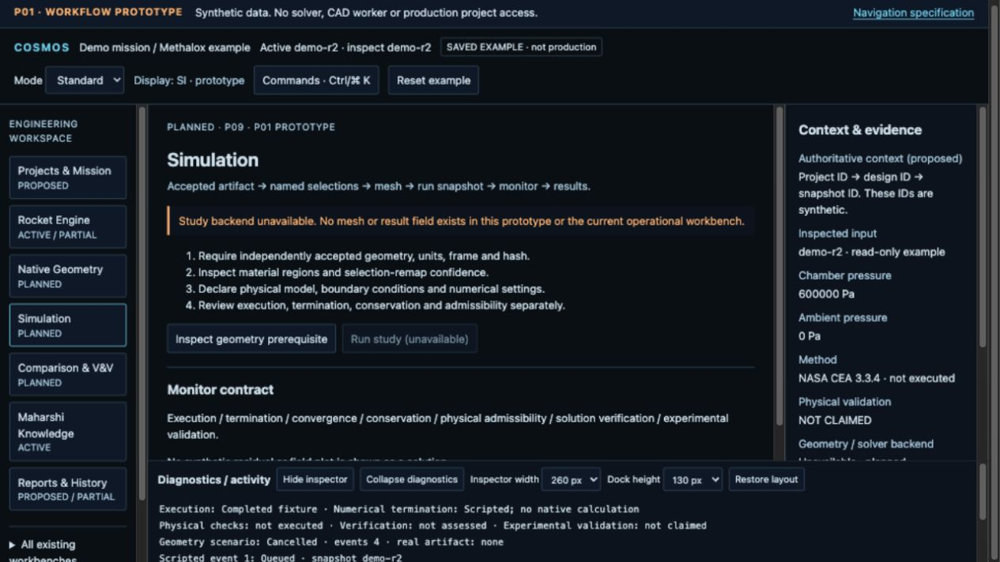
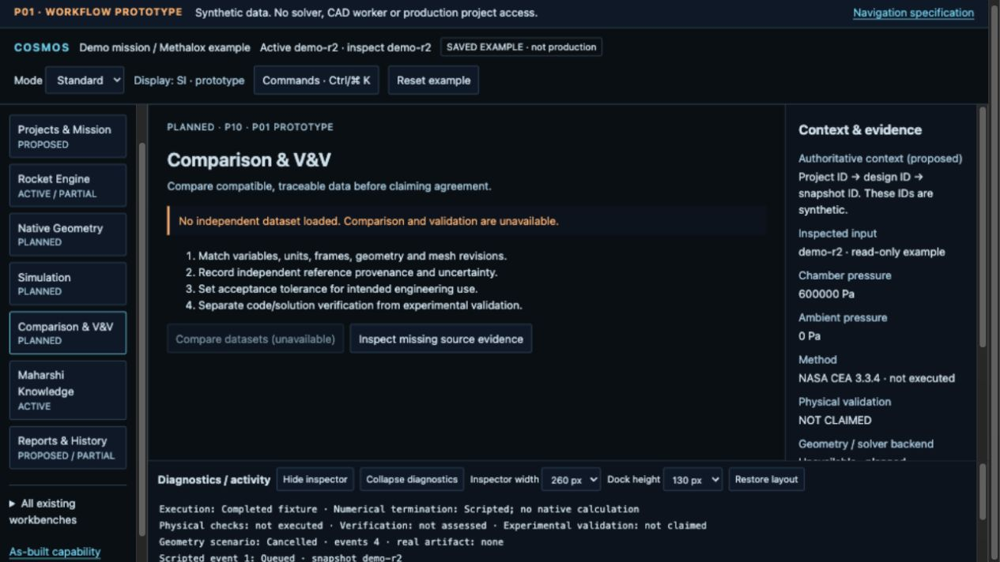
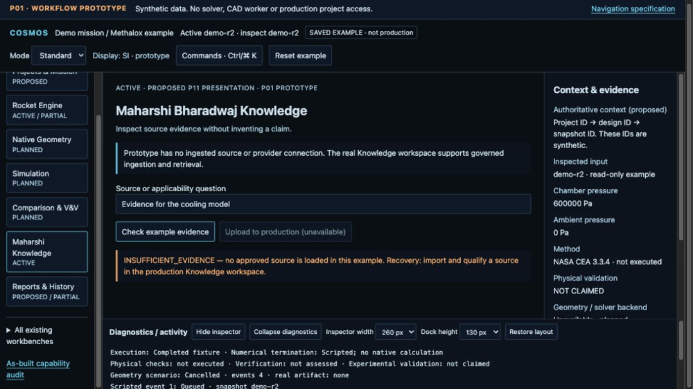
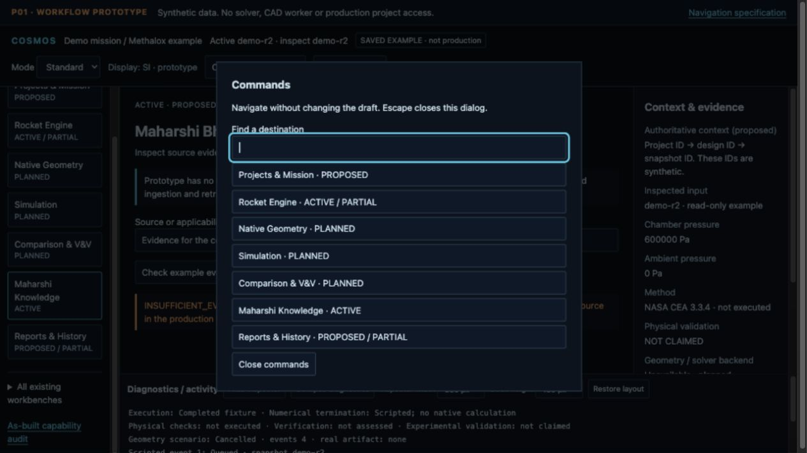
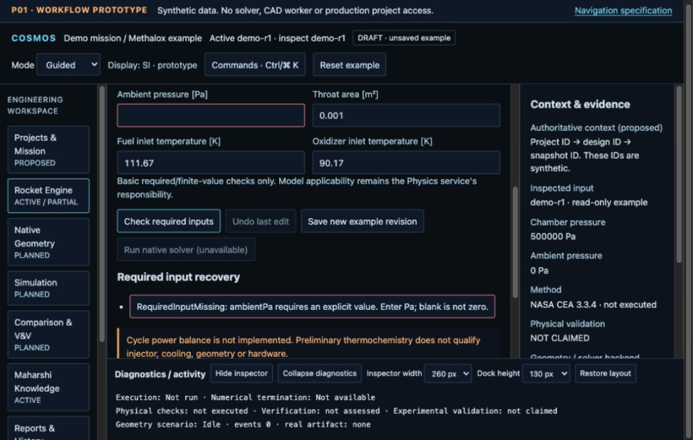

# P01 — Structural wireframes and prototype walkthrough

These are runnable task-flow wireframes, not approved final visual design. The prototype is isolated from production. It uses synthetic in-memory input/revision/result/job states, not native scientific software.

Preview: `http://127.0.0.1:8791/P01_2026-10-08/prototype/`.

If the preview server has stopped, from the repository root run:

```sh
python3 -m http.server 8791 --bind 127.0.0.1 --directory docs/implementation/evidence
```

No dependency installation, credentials or production project access is required. Reload resets example scientific data; only dedicated prototype layout preferences persist. Reset example requires confirmation and affects this prototype's memory only.

## Layout contract

Persistent top project/design/base/inspected-revision context; left workbench navigation and legacy catalog; center active task; right source/input inspector; bottom diagnostics/history. Supporting panels collapse and recover without losing draft state. Prototype resizing uses keyboard-operable width/height presets; full continuous SplitDock resizing belongs to P03/P04.

The dark workstation vocabulary and unit-bearing labels are grounded in the current source and [P00 screenshots](../P00_2026-10-08/P00_UI_UX_AUDIT.md). No framework migration, decorative asset generation, scientific 3D viewer or final token registry is implied.

## W1 — Project entry and global context



Open the example project, or inspect history. Distinguish durable project identity proposed for P04 from the current browser preference. Every destination remains visible with current maturity. No new project service is connected.

## W2 — Rocket preflight and error recovery



Requirements needed by the active calculation appear in one task. Missing ambient pressure has a specific recovery link; it must not become zero implicitly. Basic input readiness does not claim native model validity. Critical scientific controls/limits remain visible in all density modes.

## W3 — Old revision inspection without draft loss



The active base is demo-r2, while read-only inspection shows demo-r1. Original result evidence remains stale for r2. Inspection does not change the active draft or relabel old evidence. The history is synthetic; current DesignStore does not provide this complete immutable revision service.

## W4 — Planned geometry QA and cancellation





Real build/export remain disabled because no kernel is connected. Scripted warnings demonstrate revise/rebuild recovery; rejection cannot publish a real artifact. Cancellation is requested before acknowledgement. Representation and source/export tolerances are explicit requirements, not fabricated accepted values. No fake geometry image or topology result is displayed.

## W5 — Planned simulation prerequisites



Accepted geometry, selections/materials/frames, mesh and a fixed study/run configuration are required before execution. Numerical and physical result dimensions stay separate. No placeholder residual/field plot is represented as a computed solution.

## W6 — Comparison blocked without independent reference



Comparison requires compatible variables, units, frames/revisions, provenance, uncertainty and an intended-use acceptance policy. No absent dataset can produce verification or validation acceptance.

## W7 — Knowledge source absence



An empty source environment returns `INSUFFICIENT_EVIDENCE`. Source import/qualification is the recovery, not an invented citation. Real Knowledge ingestion exists but is not connected to this prototype.

## W8 — Keyboard commands



Commands navigate without changing the draft. Ctrl/Command+K opens search; Tab/Shift+Tab wrap inside the dialog; Escape restores focus. An initial native reverse-tab gap was fixed with explicit wrapping and retested. Native production command behavior was not changed.

## W9 — Minimum supported desktop / Guided mode



Viewport requested: 1100×700. DOM inner width is 1100; available document width is 1085 after the vertical scrollbar. Horizontal scroll width also is 1085, so no outer horizontal overflow was observed. Top context stayed at y=36–134. Two-column inputs preserve units and required-field recovery. Panel collapse/recovery preserves task space.

Screenshots are backend-returned JPEG bytes with `.jpg` names; captured content pixels exclude some browser/scrollbar edges and are not asserted to equal the requested viewport pixel-for-pixel. Minimum viewport and context were checked from live DOM, not inferred solely from image dimensions.

## Prototype interaction boundary

Working controls: primary navigation, open example, edit/undo, basic preflight, example revision save/inspection, fixture results, scripted geometry state transitions, no-source query, presentation modes, commands, safe reset and recoverable layout presets. Unavailable controls: native calculation, real geometry/CAD export, simulation run, external-data comparison, production upload and report publication. Those controls expose real future prerequisites.

Follow the six review tasks in [task flows](P01_TASK_FLOWS.md). The [review record](P01_REVIEW_RECORD.md) identifies what was checked automatically and what still requires owner/internal-user review.
