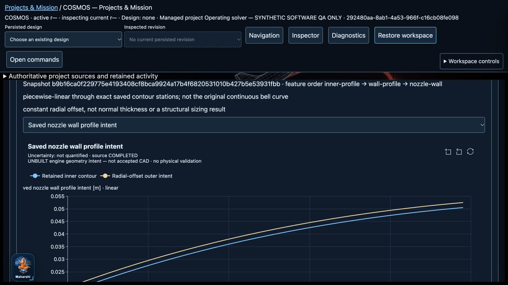

# R06 selected-software handoff and R07 start

Date: 2026-10-20. HEAD: `293223ebef190eaa647e67dc581eb186b2b5d987`. Qualification applies to the inherited dirty working tree plus the explicitly recorded changes, **not** a pushed commit, remote CI, release, flight or hardware acceptance.

## Decision

**The approved steady pressure-fed / gas-generator software profile is implemented and locally qualified. R07 has begun.** The broader R06 product wish list is not entirely implemented: undeclared pressurant sizing/blowdown, injected-film operating feedback, phase-change conditioning, other cycle architectures, global sensitivity and full-engine physical fidelity are not silently added or counted as passes. Physical validation remains `NOT_PERFORMED`; no measurements exist for the QA project.

This is a scoped software handoff, not a claim that every future RKT-01–08 extension or physical gate is complete. The task board retains unchecked broader requirements. R07 is independently allowed to proceed from exact saved design inputs; it does not depend on inventing physical validation.

## What changed

### R06: coupled local sensitivity

- `systems/cycle/operating_sensitivity.py`: exact-recipe one-at-a-time sweeps over selected feed pressures, temperatures, quadratic resistances/pump coefficients and GG effective throat area. Every case independently invokes the existing operating solver, including native NASA CEA HP and the selected thermal feedback model. No frozen-output differentiation.
- Explicit 3–5 increasing samples, baseline inside their interval, physical SI units, centered h and h/2, source/applicability statement and admission budget. At most ten distinct solves; exact floating-point samples are not snapped together. Each running solve retains its original declared solver policy. The study checks its budget between solves; it is not a cancellable native process/job.
- Each case retains its complete recipe, result or failure. Nonconverged/inadmissible states are invalid samples, never successful last iterates. Both stencil sides are retained. Invalid baseline/stencil means unavailable derivative, without a one-sided substitute. Curves split at invalid domains; isolated valid samples remain in the source/CSV.
- Reuses `numerics/sensitivity/local.py`. h-versus-h/2 difference is a diagnostic, **not an error bound**, global sensitivity or propagated uncertainty.
- `systems/projects/operating_sensitivity.py` reuses R05 durable captures, CAS baseline admission, exact-command replay, method/runtime currentness, retained failure/history/restart and project membership. The older assumed-state sensitivity service is preserved.
- `api/engineering_extensions.py` adds authenticated `/api/projects/{project}/operating-sensitivity` capabilities, captures, results, exact input/record JSON, evaluated-case CSV and source-bound plots.
- `gui/static/managed-engine-extensions.js` adds explicit Projects controls choosing an exact retained current operating recipe and baseline. No auto-filled scientific sample ranges or steps. Results, invalid cases, derivative availability, capture recovery, history, plots and CSV/SVG/source bundles are inspectable.
- Scoped client request timeouts now accommodate bounded scientific work: 240 seconds for a sensitivity request and 180 seconds for the operating request. Ordinary requests remain at 20 seconds. This changes transport patience only, not scientific budgets, equations or tolerances. Project transport preserves the override; the JS regression tests this behavior.

### R06: validation preparation for the actual solved candidate

- `systems/projects/operating_validation.py` maps retained solved outputs—not the older imposed pressure/performance result—to predeclared comparison targets. Supported targets include thrust, core mass flow, solved chamber pressure/O/F/GG speed, coolant return temperature, pressure loss and heat pickup when available in the chosen model.
- Exact feed conditions, propellant identities, pump/branch assumptions, contour dimensions and wall/channel properties accompany the predictions. Solved chamber pressure is an output target, not an imposed input matching condition.
- `systems/projects/propulsion_validation.py`, `api/propulsion_validation.py` and the existing Projects panel now accept current usable operating candidates. Composition checks actual upstream dependencies and operating method/runtime fingerprints. A failed, historical or method-stale candidate cannot create a new plan.
- Original predeclared criteria, blank templates, raw imports, covariance-aware reported-output comparison and independent-review blockers are reused. Legacy propulsion-baseline planning is retained. No acceptance route or invented measurement data was added.

### R07.1: real engine-derived nozzle intent

- `systems/geometry/engine_intent.py`: maps an actual CURRENT saved 2–257-station divergent contour into the existing immutable P06 `DesignSnapshot`, `SIParameter`, `CoordinateFrame`, `SourceReference`, `GeometryFeatureGraph` contracts.
- Snapshot namespace is `engine-design-{design_id}`, not `p07-software-fixtures`. Original design/configuration text and SHA256, saved contour result/model, exact source commit, and explicit template inputs are retained through the managed outer envelope. The namespace itself does not create a new Project record.
- Explicit template: `divergent-nozzle-radial-wall-v1`. +X from throat, right-handed metres. Strict monotonic finite positive contour, explicit radial wall thickness/applicability and separate source/export tolerances. No frame repair, missing geometry defaults or invented chamber/injector/channel dimensions.
- Intent DAG: inner sampled profile → closed radial-wall profile intent → X-axis revolve intent. Existing DTOs prove dependency order and reject invalid bindings/cycles. Reversible-copy dependency-impact tests show a wall edit invalidates the wall and revolve, not an unrelated inner profile.
- Inner samples are preserved exactly. The outer intent uses a **radial** offset, not normal thickness or a structural sizing result. Piecewise-linear interpolation is expressly not the original smooth bell curve.
- `systems/projects/engine_geometry.py`, `/api/projects/{project}/engine-geometry-intent` and the Projects panel add captured input/result originals, history, currentness, source navigation and a labelled inner/outer intent plot. Downloads say `COSMOS-unbuilt-engine-intent-…`, not software fixture or accepted CAD.
- **No native build is invoked.** Backend is null, artifact list is empty, engineering-export eligibility and production handoff are false. Existing fixture allowlists/workers/QA/export authority remain unchanged. Graph operation names describe intent, not backend capabilities.

## Executed qualification

| Gate | Result |
| --- | --- |
| Pre-edit bounded/nonadiabatic/operating baseline | 23 passed |
| Final full Python suite | **3534 passed, 93 skipped**, 238.24 s; 0 failed/errors |
| Previous pytest identities | All retained; **20 additional cases** |
| Final JavaScript | **424 passed**, 0 failed/skipped |
| Ruff production/test scopes and new collector/checker | PASS |
| Mypy | PASS, **412 production source files** |
| TypeScript 5.9.3 | PASS, all **seven** existing strict consumers |
| Source preservation vs preceding R06 closure manifest | **1358 unchanged**, 11 declared edits, 0 missing/unexpected; no old Core/Physics/Numerics source changed |
| Actual browser → API → SQLite → plots/downloads → restart | PASS, `ui-export-proof.json`; browser error console empty |

Final receipts: `full-python-final.log/xml`, `test-summary.json`, `javascript-final.log`, `mypy-final.log`, `ruff-final.log`, `typescript-final.log`, `preservation.json`, `source-final.json`, `ui-export-check.log`, `ui-export-proof.json`, `ui-restart.txt`, screenshots and `ui-console.json`.

Earlier development failures and the earlier full-suite pass are retained under distinct filenames. They are not substituted for final qualification. One earlier TypeScript command used an incompatible deprecation option; the final command uses the detected 5.9.3 runtime and passes. No failed test identity was removed or xfailed to get a pass.

Native CI coverage was extended in `.github/workflows/ci.yml`, but **remote CI was not run**: no commit, push or PR was requested. The saved CEA test cache was copied/restored and compared; final SHA256 `6ea2f6250df4143d6ca452a552a3dfbae7e5f6a87d2613cd566f0b0dc0fa2508` is unchanged. Final backup `/private/tmp/cosmos-r06-r07-final-cache.xSM3f5` is retained.

## Browser evidence and data preservation

The verification skill required the complete user story, not only a successful HTTP return: exact saved source → explicit form → input capture → real native evaluation/intent capture → retained rows → source-bound chart → actual downloads → server restart → identical originals/history.

Isolated root: `/private/tmp/cosmos-r06-operating-qa.SSCtHL`. Project `292480aa-8ab1-4a53-966f-c16cb08fe098`. All source/criteria/property inputs are labelled **synthetic software QA only**. No owner project/data root or the existing port8787 listener was modified. The QA preview starts with an input baseline only; the operating/sensitivity/geometry/plan results were actually executed through the GUI, not seeded as successes.

- Actual native GG operating candidate: `8ee7b946-e673-45e2-9a91-df4f237da6cc`; conservation PASS.
- Sensitivity: `a4c0e733-7350-470b-8a1a-fb0527f77df2`, SHA256 `089f8f4a59f73c15c6b81ca3a6b84ab48fa729a4e1141695d82037c2ca62821f`. Five independent native evaluations; three requested curve samples. h=1000 Pa and h/2=500 Pa derivatives 0.0002264096314938797 and 0.00022641730547184123 N/Pa. Difference 7.673977961522886e-9 N/Pa is not a physical accuracy bound.
- Geometry intent: `ac451831-41de-46b3-a20d-f30ba20499b4`, SHA256 `30b4a745fbece2e8c5d28e48db3b41ba3ac33d1045fcfc1c45016756e3463985`. 81 retained stations, three intent features. SVG 660×512; identity bound through paired full source/provenance, not invented inline SVG hashes.
- Solved-candidate validation plan: `de081a64-aeb2-445c-9d14-b97e97afe72b`. **48 blank** measurement template rows, zero measurement records, zero comparison records. Prediction uncertainty explicitly UNKNOWN; physical validation NOT_PERFORMED, independent acceptance false.
- Original input/result downloads agree byte-for-byte with isolated SQLite authority. Post-restart result downloads match pre-restart bytes. Exact baseline bytes remain unchanged. Downloads are retained in the user's Downloads folder; exact paths/checksums are in `ui-export-proof.json`.

The demonstrated new browser workload is 81 contour stations and five distinct native sensitivity cases. The existing storage/plot size limits remain fail-closed; this receipt is not maximum-workload/interactive-latency certification for every admitted input size.

The task-created preview server is closed after qualification. Source/evidence files and the isolated test root remain recoverable; no engineering publication was made.

## Requirement dispositions and next work

- **RKT-01:** declared assumed-state plus native coupled PF/GG OAT/h/h2 sensitivity implemented/qualified; not arbitrary/global/UQ algorithms.
- **RKT-02/03:** selected steady network and regulated-pressure feed boundary qualified in the preceding solver plus this final regression. Full pressurant gas inventory/blowdown/sizing and wider framework scope remain outside the declared model, not an implicitly implemented feature.
- **RKT-04:** direct GG power/diversion assessment and solved speed/pressure/flow/thermal candidate profiles qualified.
- **RKT-05/06/07:** staged combustion, expander and electric-pump cycles are explicitly unsupported/unselected. No equations or passing status invented.
- **RKT-08:** older direct prescribed-component injector/cooling/additional-film/external-withdrawal ledgers remain qualified separately from the new no-injected-film solved thermal profile. Full injected-film/conditioner operating feedback is not claimed.
- **Physical/R15:** genuine measurement and matching material/operating evidence, reviewed uncertainty/applicability and independent acceptance remain required. Software fixtures cannot satisfy them.
- **R07 NGG-01:** selected divergent-nozzle SI/source/frame snapshot mapping implemented. NGG-02/03/06/09 have an initial intent/capture/graph/freshness slice, not complete engineering geometry. Remaining NGG requirements stay open.

Next R07 increment: retain this separate engine namespace and qualify real sampled-profile/closed-wall/revolve operations in the native job/worker pipeline. Record backend/version/tolerances and dimensional/topology/reimport evidence before offering engineer-use STEP/mesh. Then add explicitly sourced chamber/interface/injector/channel templates, editable graph revisions/undo and study-region handoff under R08 acceptance. Do not route this intent through the old sphere-fixture build endpoint.

