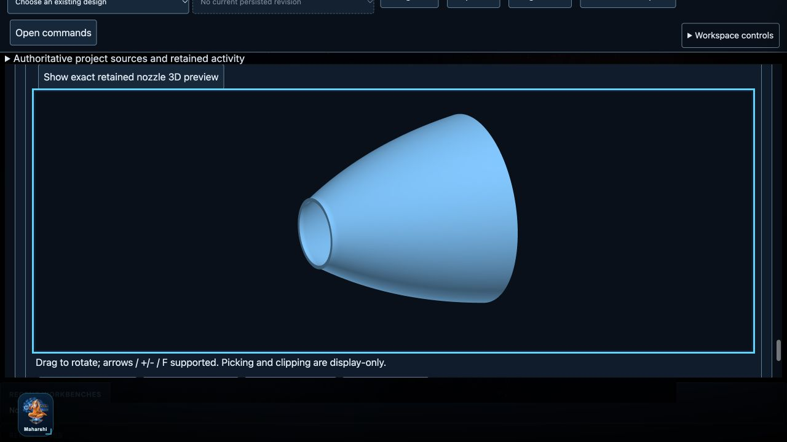

# R07 selected nozzle native integration — implementation handoff

Date:2026-10-20. Baseline HEAD:`293223ebef190eaa647e67dc581eb186b2b5d987`; inherited dirty development tree preserved. Preceding source inventory:`R06_FINISH_R07_START_2026-10-20/source-final.json`. No commit, push, live migration, release or hardware operation performed.

## Outcome and honest phase boundary

**The current selected nozzle source→native build→independent software QA→durable history/artifacts→GUI preview/download/restart integration is implemented and locally qualified.** It no longer stops at unbuilt intent. An actual81-station saved engine contour generated a valid open-bore wall solid, analytic metre STEP and metre STL; the UI rendered88,956 real retained STL triangles.

**Whole broader R07 remains partial.** Additional component templates, general editable/reversible graphs, nonidentity transforms/placement/channel operations, analytic metrology, semantic region/material/interface study handoff, evidence-bound engineering publication and maximum-workload certification remain open. The implementation does not invent component dimensions, accept manufacturing CAD, promote a solver stage or pass physical validation. See [MODEL_CONTRACT.md](MODEL_CONTRACT.md) and [OPERATOR_RUNBOOK.md](OPERATOR_RUNBOOK.md).

## Implementation evidence

| Boundary | Exact implementation | Implemented scope |
|---|---|---|
| Typed native policy | `plugins/geometry/nozzle_protocol.py`, `nozzle_adapter.py` | Separate engine namespace/version, exact graph/feature/parameter bindings, frame/SI/tolerance/size limits; original fixture allowlist intact |
| Real CAD child | `plugins/geometry/workers/nozzle_worker.py` | Pinned OCP/OCCT profile→closed wall face→X-axis revolution; one valid solid; native source, STEP/STL, exact hashes and unit metadata; no repair/fallback |
| Independent reference/QA | `systems/geometry/nozzle_reference.py`, `nozzle_qa.py`; `plugins/geometry/workers/nozzle_step_reader.py` | Kernel-independent ring integrals and meridian distance, source-labelled explicit ceilings, genus-one mesh topology, Gmsh reimport units/analytic carriers/body/bounds/volume/centroid and sampled bidirectional distances |
| Shared execution compatibility | `systems/geometry/service.py`, `authority.py`, `qa.py` | Small policy hooks; default fixture policy/reference unchanged. Conservative threshold-safe triangle filtering; bounded/cancellable nozzle mesh QA |
| Durable engine authority | `systems/geometry/engine_builds.py`, `nozzle_workspace.py`; `infrastructure/persistence/durable_jobs.py` | Immutable exact intent/snapshot/graph/request/QA/runtime/method/command capture, existing durable attempts/stages/blobs/CAS/permissions/cancel/retry/recovery; exact stage retry namespaces checked before replay |
| Authenticated orchestration | `api/nozzle_geometry.py`, `api/project_authority.py`, `api/context_projects.py` | `/api/projects/{project}/engine-geometry-builds`, candidate-scoped original downloads and exact-STL preview, current methods/upstream/runtime eligibility, historical originals readable without a runtime |
| GUI integration | `gui/static/managed-engine-builds.js`, `projects.js`, `gui/server.py` | Explicit intent/QA inputs with no engineering defaults, bounded attached-panel polling, original-operation uncertain replay, exact cancellation/history, QA table and real WebGL preview using existing renderer; original fixture tools preserved |
| Reproducible qualification | `scripts/qualify_engine_nozzle_runtime.py`, `verify_r07_runtime_boundary.py`, `collect_r07_native_evidence.py`; `tests/ui/r07_nozzle/preview.py` | New source/runtime-bound campaign rather than rewriting old G5 receipts; optional native tests, read-only manifest negatives, real isolated browser/download/restart proof and source/test preservation |

Systems retains geometry intent/reference/QA and source orchestration; Plugins retains native operations; Infrastructure owns processes/persistence; API/GUI orchestrate/present. A regression test found a deep GUI import during development; it was moved behind `api.nozzle_geometry.create_workspace`, **not** exempted from the architecture gate. A subsequent native restart test found a typed unavailable-runtime exception escaping a read; it was fixed to preserve readable originals while denying current-candidate eligibility. Earlier failed/in-progress campaign evidence is retained and not used as final acceptance.

## Final verification

| Check | Actual result | Evidence |
|---|---|---|
| Full Python | **3543 passed,100 skipped,0 failed/errors**,226.64s | `full-python-verified.xml`, `test-summary.json` |
| JavaScript | **426 passed,0 failed/skipped** | `js-final.log` |
| Static/architecture | Ruff PASS; Mypy **417** production files PASS; existing **seven** strict TS consumers PASS | `ruff-final.log`, `mypy-final.log`, `typescript-final.log`, full Python architecture cases |
| Selected real-native campaign | **7 passed,0 skipped/failed** | `native-final-v4.xml`: straight/curved, three explicit tessellation levels, pinned health, missing-worker failure/timeout, launched-session cancellation, actual81-station managed HTTP source/bytes/access/staleness/restart and failed-QA/cancel guards |
| Preserved fixture campaign | **31 passed,0 skipped/failed** | `fixture-regression-v4.xml`: existing PicoGK/OCCT primitive/Boolean/refinement/empty/export/health/cancel paths |
| Runtime gate negatives | Valid profile accepted; **8 unsafe/mismatched copies rejected**, no native execution | `runtime-negative-proof.json` |
| Real browser journey | Source capture, blank-QA refusal, native admission/completion, actual STL preview/clipping/orientation/keyboard zoom, four materialized browser downloads, clean restart/re-read/re-download; no console errors | `ui-final.txt`, `ui-restart.txt`, screenshots, `ui-export-proof-final.json`, `ui-export-proof-restart.json` |
| Preservation | **1375** preceding source files unchanged; **9** declared edits; **0** unexpected/missing; **16** new test cases and no preceding case removed | `source-final.json`, `preservation.json`, `test-summary.json` |

The100 default-suite skips are explicit optional native qualifications and pre-existing Knowledge hashability gaps, not passes. The selected7 native cases and31 legacy fixtures were separately executed against the final qualified identities. Wider optional native studies/copy/migration campaigns were not all rerun. This is dirty-worktree local evidence, **not current remote CI or release acceptance**.

No preceding Core, Physics or Numerics source changed. The full-suite cache fixture was protected/restored: `cache/cea/test_key.json` SHA256 remains `6ea2f6250df4143d6ca452a552a3dfbae7e5f6a87d2613cd566f0b0dc0fa2508`. Existing owner-data roots and historical receipts were not migrated/resealed.

Cleanup: the verified task-owned preview listener on127.0.0.1:8875 was gracefully stopped and the port rechecked free; the task browser tab was closed. Synthetic QA state, generated evidence and downloaded originals were retained. The user's existing8787 service was not stopped or changed.

## Actual final candidate and restart proof

Task-owned root:`/private/tmp/cosmos-r07-nozzle-qa.HkJ3cD`. Project:`3344d11e-2a38-44b2-9009-0540bfcf093b`; build source:`53fdbbb0-b4df-469f-a692-6f92d805c029`; durable job:`451fd6e3-4acd-458b-9b34-6b1bf1670e35`.

- Real source has81 stations, wall intent2mm and user-entered synthetic QA ceilings (not owner manufacturing values). One solid,162 STEP faces, two end annuli; closed STL is one connected genus-one wall.
- STEP relative volume discrepancy:`3.73e-14`; centroid discrepancy:`4.10e-15m`; sampled forward/reverse maxima approximately`6.03e-15m`/`6.00e-15m`. These compare the saved polyline reference, **not an ideal continuous bell or physical engine**.
- STL relative volume discrepancy:`9.18495e-5`; centroid:`2.73874e-7m`; sampled forward/reverse maxima:`5.54463e-6m`/`8.27320e-6m`. Explicit software ceilings were0.005 [1],20µm centroid and20µm distance.
- Actual retained preview:266,868 vertices /88,956 triangles. Browser-downloaded input/record/STEP/STL SHA256 values equal retained bytes before and after restart, with the same preview hash and six native stages. The final candidate remained current without rebuilding. The earlier method-bound candidate remained byte-identical and correctly historical (`ui-export-proof-oldrestart.json`).
- Gmsh/OCP share OCCT; separate process/tool/API plus independent formulas are not a different-kernel proof. Samples are not certified Hausdorff bounds or universal self-intersection certification. Generated `accepted` means the named **software-candidate** policy only.

## Requirement disposition / next work

- NGG-01 remains selected-source complete. NGG-02/04 now have the actual divergent radial-wall profile/revolve template, not all requested components/operations.
- NGG-06 is complete **for this selected nozzle profile**: exact intent/backend/version/representation/tolerances survive capture/build/reimport/download/history.
- NGG-09/10/12 now have real selected-nozzle durable rebuild/currentness/history, candidate exchange and bounded process/failure/cancel/restart evidence, but general graph editing, engineering publication/study handoff and maximum workloads remain open.
- NGG-03/05/07/08/11 broader editor/transform/conversion/analytic-metrology/semantic-handoff requirements are not silently closed.
- Early GEO policy/reference/topology/refinement/sample/reimport work supports this nozzle only. It does not close broader R08 acceptance or qualify arbitrary engine geometry.

Next appropriate work is a source-backed component/feature-editing contract and semantic boundary/interface handoff for the selected next engineering use case. No automatic manufacturing release, experimental validation or owner-data rollout is justified by this software result.
