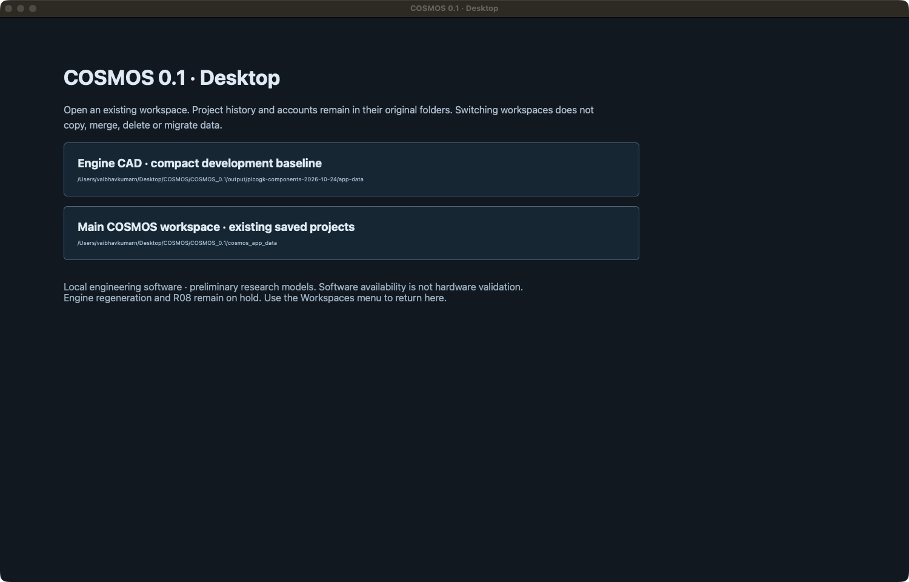

# Guided Engine Design — proposed implementation plan

Date: 2026-10-29 (Asia/Kolkata). Status: PROPOSED, NOT IMPLEMENTED OR APPROVED.

## 1. Decision requested

Make Guided Design the normal way to start an engine. Ask for six starting
decisions, resolve the remaining supported inputs through a versioned engineering
profile, show one review of the important assumptions, and execute the supported
calculation chain. Preserve the current detailed editors as Expert Mode.

This is not a proposal to hide missing physics, invent source data, or call a
preliminary concept a qualified engine. Automation should remove transcription
and navigation, not engineering traceability. Full engine generation and R08
remain ON HOLD unless the user separately resumes them.

Only this proposal, its planning canvas and a current screenshot were created.
No application source, live data, runtime profiles, installed app or credentials
were changed. No solver, geometry build, test campaign, migration, commit or
push was run for this proposal.

## 2. Current evidence and scope

Repository base: /Users/vaibhavkumarn/Desktop/COSMOS/COSMOS_0.1.
HEAD inspected: 293223ebef190eaa647e67dc581eb186b2b5d987; the checkout is dirty.
Source observations below are not a claim that every path was exercised live.

- gui/static/propulsion-suite.js, buildWorkflowCard(): exposes O/F, expansion
  ratio, assumed Tc/gamma/MW, throat area, L*, contraction ratio, wall thickness,
  boundary conditions and catalog selections in the top-level workflow.
- The same file, subsystemFields(): asks users to enter liquid densities,
  viscosities, Cd, injector pressure drops and hole counts, plus extensive
  coolant properties, property limits, channel dimensions and film settings.
  These fields mix requirements, lookup data, design decisions and outputs.
- systems/requirements/models.py, DesignRequirements: explicitly retains
  missing values as None and prohibits silent engineering defaults. Preserve
  this contract: a guided resolver must supply explicit, source-labelled inputs.
- systems/workflow/orchestrator.py and graph.py: reusable staged execution,
  dependencies, CURRENT/STALE semantics and limited-model diagnostics exist.
- api/propulsion_workflow.py: existing input mutation, stale invalidation and
  copy-before-validation contracts can be reused rather than bypassed.
- scripts/build_methalox_1500n_concept.py: a specific existing study demonstrates
  bounded CEA O/F selection, nozzle sizing and target-thrust scaling. It is not
  a generic validated design assistant; its IO and case assumptions must not
  simply become global defaults.
- systems/propellants/nist_liquid.py: already validates retained NIST species,
  state, phase, units, reference state and checksums. General profile coverage
  and automatic selection are additional work.
- knowledge/foundation/material_binding.py and knowledge/models/property.py:
  source identity, lifecycle and validity-range foundations are reusable.
- physics/materials/catalog.py: typical near-room-temperature records have
  explicit limits; these are not general hot-wall design allowables.
- systems/cycle/operating_contract.py: operating-point solving requires explicit
  liquid property/phase windows, feeds, model bounds and solver tolerances.
- gui/static/engine-redesign.js: a development selection is intentionally not a
  generated mesh or automatically matched physics result. New UX must preserve
  that distinction while making existing artifacts easier to find.

Current native inspection reached the workspace chooser (01-current-chooser.png).
It shows two separate data roots. No root switch or login was performed. This is
a source-grounded workflow proposal, not a completed live input-flow or human
usability audit. Keyboard, screen-reader and task-completion testing is planned.

## 3. The proposed normal experience

### Step 1 — Define the engine

Six starting decisions (a propellant pair has two selections):

1. Target thrust, with units and operating condition.
2. Fuel and oxidizer combination.
3. Chamber pressure, explicitly absolute; gauge entry requires a reference.
4. Environment: sea-level standard, vacuum, altitude model, or custom ambient.
5. Burn duration, or an explicit steady-performance-only scope without duration.
6. Engine cycle; pressure-fed is the first fully integrated guided profile.

An autogenerated project name is editable but not a scientific requirement.
The default scope is preliminary computational design, visibly labelled.
Storage/inlet state, cooling and fabrication profiles appear in the next step,
not as dozens of blank numeric boxes. If no applicable profile exists, ask a
short conditional question; do not pretend six inputs determine every engine.

### Step 2 — Review the proposed engineering basis

COSMOS recommends a compatible profile and displays its important decisions:
reactant inlet state, optimization objective, cooling architecture, injector
model family, material/process candidates and any provisional feed assumptions.
Each decision has a plain-language reason, evidence type, applicability and
source link. The user can accept the profile once for this design or customize.

Separate recorded sources into: user input, calculated result, source property,
correlation-based recommendation, provisional assumption and unresolved value.
An override is recorded as an action on the original basis, not as a replacement
source. Unknown uncertainty stays unknown, never zero or an invented confidence
percentage. Literature sourcing does not mean physically validated.

Approval binds an exact profile version, resolved-input hash and design revision.
A new design, changed scope, material/process, invalid state or materially changed
basis requires a focused re-review. No approval of a historic 5 s / 8 bar study
is silently extended to all future engines.

### Step 3 — Calculate and inspect

One primary action: Calculate preliminary design. Display a compact progress
view with pending/running/succeeded/blocked/failed/cancelled stages. Preserve
useful independent results if a downstream model is blocked. Failures identify
the cause and one actionable next step; technical logs remain expandable.

Results begin with achieved versus requested thrust, ideal performance,
mass flows, principal dimensions, pressure/thermal margins where supported,
assumptions and unresolved checks. Never imply all checks passed because a job
finished. Existing validation/readiness semantics remain separate.

### Step 4 — Open or generate geometry

The same engine page owns Calculations, Components, 3D Model and Evidence tabs.
Open a compatible retained model without rebuilding. If the selected geometry
has no artifact, say so and offer explicit generation, not a blank viewport.
Show source revision and whether geometry matches current calculations.

Use a small, clearly labelled concept preview before a large native build.
PicoGK implicit/mesh output and OCCT analytic/STEP output remain distinct.
Full builds require explicit storage/output choices, free-space preflight and
cancellation. Opening a retained model must not require generation or R08.
Existing separate data roots are not silently merged; any cross-root import or
relinking requires a source-bound preview and explicit approval.

## 4. What automation should do

### Calculate instead of asking

- Use NASA CEA to obtain chamber/combustion thermochemical properties, rather
  than asking users to type Tc, gamma and molecular weight in normal CEA mode.
- Perform bounded O/F and nozzle-expansion studies for a declared objective
  and operating environment. Report finite-search/model limitations; ideal Isp
  optimization is not proof of best real-engine efficiency or stability.
- Size throat/exit geometry and mass flow consistently with target thrust in
  target-driven sizing mode. The user should not independently type both thrust
  and throat area unless intentionally adding a constrained/existing design.
- Derive chamber/contour geometry from a declared applicable rule/profile.
  Expose L*, contraction ratio and contour choices in advanced controls.
- Populate fluid properties at the actual local temperature/pressure and phase,
  with bounded interpolation and a consistent enthalpy reference.
- Generate supported injector/cooling candidates using discrete searches with
  declared bounds, then rank feasible candidates against stated objectives.
  No feasible candidate means infeasible or unresolved, not relaxed criteria.

### Recommend, with visible preliminary assumptions

- Inlet/storage conditions when a matching named operating profile exists.
- Injector Cd/count/pressure-drop basis where no measured component data exist.
- Cooling layout, roughness, channel count/geometry and manufacturing envelope.
- Material plus process/heat-treatment candidates, never an alloy name alone.
- Line/manifold sizes and required regulated feed pressures from a supported
  pressure budget, clearly distinguished from actual available tank pressures.

These recommendations need engineering rules and applicability evidence, not
just values found in a textbook. Defaults are explicit profile inputs once
accepted, not hidden constants inside Physics or the GUI.

### Never silently invent

- Measured combustion efficiency, injector Cd, stability margins or test data.
- Certified allowables, process/lot properties or material temperature limits.
- Supplier-selected seals, cryogenic/oxidizer compatibility or leak criteria.
- Manufacturing tolerances, pressure-test approval or flight/hot-fire readiness.
- Pump/turbine maps for an unsupported or insufficiently characterized cycle.
- Missing fluid phases/boiling models, unsupported physics or evidence coverage.

## 5. Source and parameter resolution design

Add an explicit orchestration layer in Systems, not numerical logic in the UI.
Maintain the frozen layering: GUI collects decisions; API authorizes/validates;
Systems resolves and orchestrates; Physics/Numerics calculate; Knowledge exposes
source metadata; infrastructure owns persistence and worker execution.

Proposed records (names to confirm in implementation; not existing APIs):

- EngineBrief: the small user intent, scope and optional locks.
- EngineeringProfile: allowed regimes, selection rules, sources, candidate
  bounds, model IDs, property packages, version and intended-use limits.
- ResolutionPlan: values proposed for use, conflicts, conditional questions,
  dependency graph and stages enabled/blocked before any run.
- ResolvedEngineInputs: explicit units, source category, source/record hash,
  applicability, derivation dependencies and accepted overrides for every value.
- DesignRun: exact brief/profile/resolved inputs, solver versions/settings,
  stage receipts, artifacts, readiness and reproducible explanation bundle.

Resolution order: explicit user lock -> compatible previously accepted value ->
applicable reviewed source/model -> approved profile rule -> visibly provisional
proposal -> unresolved. Conflicts are reported; user values are not silently
replaced and a conflicting pair of locks produces an overconstraint diagnostic.

Use two explicit engineering modes. Guided target sizing chooses free dimensions
to approach requested thrust/Pc within bounds. Existing-hardware evaluation uses
known feeds, geometry and resistances to solve the operating point; achieved
thrust/Pc are outputs. Do not overconstrain both by silently tuning feed values.

Thermal/feed feedback must re-evaluate local property states and applicability.
Use bounded coupled iteration, convergence/residual checks and conservation
tests. Missing hot properties, phase changes outside the model or absent cooled
wall/joint models block the corresponding conclusion even if ideal performance
can still be calculated. Changing thrust reruns sizing; it is not blanket
geometric scaling or a guarantee of arbitrary-thrust support.

### Sourced data packages

Start with local, reviewed, versioned methalox/pressure-fed research packages.
Use existing CEA and retained NIST adapters. Retain raw references/response hashes,
units, reference state, valid T/P/phase windows, processing rules and licensing.
Offline replay uses exact accepted packages. Network failure uses a compatible
cached version or clearly blocks the dependent stage, never a random fallback.
Source updates create a new version and impact preview; they never mutate a
previous design. Budget storage and deduplicate by hash.

The materials library and patents are discovery inputs, not immediately trusted
calculator inputs. Extract page/table identity, qualify applicability, resolve
conflicts, then review the numerical record before making a source package.
An LLM may help find/explain candidates; it must not approve records, execute
document instructions, invent values or bypass the deterministic resolver.

## 6. Implementation sequence and acceptance gates

These are guided-design work packages, not a renumbering or resumption of R08.

### GD-00 — Input inventory and interaction contract

Map every visible field to requirement/derived/property/decision/numerical setting;
identify its source, consumer, validity, present model support and override rules.
Agree six starting decisions, conditional profile questions and intended use.
Acceptance: no field silently disappears; every hidden normal-mode input has an
explicit resolution or an honest unresolved/unsupported state.

### GD-01 — Deterministic resolver and source package foundation

Implement the proposed records, unit/state/phase checks, explanation trace,
review/approval preview, immutable storage, locks, conflicts and invalidation.
Reuse existing project authority and knowledge contracts.
Acceptance: identical pinned inputs replay identically; source updates are
nonmutating; conflicting/missing/out-of-range sources fail clearly; override
provenance and permissions survive save/reload/export.

### GD-02 — Guided performance and target sizing

Productize the existing methalox study logic using reusable services and bounded
search, rather than executing a case-specific script against live accounts.
Connect CEA -> O/F/expansion selection -> throat/mass-flow sizing -> chamber and
contour -> target comparison. Record ideal versus corrected/modelled scope.
Acceptance: approved fixture targets are met within a predeclared software
tolerance; no manual Tc/gamma/MW/throat-area/property entry for a covered case;
off-domain cases and pressure/environment incompatibilities are rejected.

### GD-03 — Feed, injector, thermal and material assistance

Build compatible profile candidates and supported search/coupling around existing
models. Prioritize source gaps explicitly; do not present GUI wiring as completion
of unfinished matched thermal/feed/wall/joint science.
Acceptance: supplied-feed and required-feed results cannot be confused; pressure,
mass and energy checks are retained; geometry/property/manufacturing constraints
are enforced; missing allowables/seals remain unassessed. Limited pressure-fed
coverage ships before more complex cycle automation.

### GD-04 — Guided UI and understandable status

Add the four-step flow, contextual help, source drawer, profile acceptance,
undoable overrides and progressive disclosure; retain detailed Expert Mode on
the same saved inputs. Show decisions rather than raw JSON or IDs by default.
Acceptance: a covered preliminary case starts with six decisions and one profile
review; zero manual rho/mu/cp/k transcription; keyboard/zoom/error recovery and
save/reopen work; switching modes neither loses edits nor changes values.

### GD-05 — Same-project CAD and results handoff

Bind selected geometry and exact generated artifacts to the run summary. Expose
Open existing 3D model prominently, distinguish original/compact candidate and
absent/stale artifacts, preserve roots and history. Use existing viewport tools.
Acceptance: users can find/open a retained model without regenerating, no unrelated
fixture is substituted, and a new design result cannot borrow another source's
mesh. Full generation stays gated by storage and the explicit pause.

### GD-06 — Qualification, human tasks and native-app delivery

Unit/property/HTTP/native-renderer tests, regression against frozen accepted cases,
negative paths and deterministic replay. Test source conflicts, absent packages,
offline mode, stale data, profile changes, cancellation, infeasible sizing,
phase transitions, unsupported cycles and insufficient disk space. Ask real users
to (1) create/review a preliminary case and (2) reopen it, explain one assumption
and find the matching retained model. Record observed time/errors; do not invent
a successful usability study.

Rebuild and separately qualify the installed desktop snapshot; source changes
do not automatically appear in the existing .app. Provide rollback without
deleting baselines or migrating old roots implicitly.

Dependency order: GD-00 -> GD-01 -> GD-02 -> GD-03. GD-04 interaction design can
proceed after GD-00, with functional integration after GD-01/02. GD-05 depends
on the exact-run contract and usable source/artifact bindings. GD-06 qualifies
each slice and gates final desktop delivery. Supported performance-only delivery
may precede broader subsystem automation, with its scope explicit.

## 7. Suggested first acceptance case

Use a separate test fixture derived from the existing 1.5 kN / 5 bar absolute /
LOX-methane / sea-level / pressure-fed brief. Offer the previously used 5 s and
cryogenic inlet states as labelled proposals for this fixture, not universal
defaults or renewed approval for live installation. No large engine build is
needed to test the resolver or opening an already retained model.

Success means a user can enter the brief, understand and accept a source-bound
profile, run supported preliminary calculations, distinguish limitations, reopen
the result and locate compatible existing CAD without hunting through UUIDs.
It does not mean a fully optimized or physically validated engine is delivered.

## 8. External references checked for this proposal

- [NASA CEA documentation](https://nasa.github.io/cea/): equilibrium composition,
  thermochemical/transport properties and theoretical rocket performance. Basis
  for automating thermochemistry, not proof of measured engine efficiency.
- [NIST fluid systems](https://webbook.nist.gov/chemistry/fluid/): species/state-
  dependent thermophysical data, units and standard-state choices. Supports
  reviewed property lookup, not source-free constant properties for a hot path.
- [NIST thermophysical property overview](https://www.nist.gov/publications/thermophysical-properties-fluids):
  phase/reference-state and uncertainty distinctions. Consult original references
  for applicable uncertainty instead of assigning arbitrary confidence scores.

## 9. Approval scope

Recommended next action: approve GD-00 through GD-02 first (contracts, reviewed
data and preliminary performance automation), retaining Expert Mode. Then qualify
and add GD-03 through GD-06 incrementally. This proposal does not authorize data
migration, manufacturing decisions, a baseline deletion, a full-engine build,
R08 resumption, external publication or commit/push.
